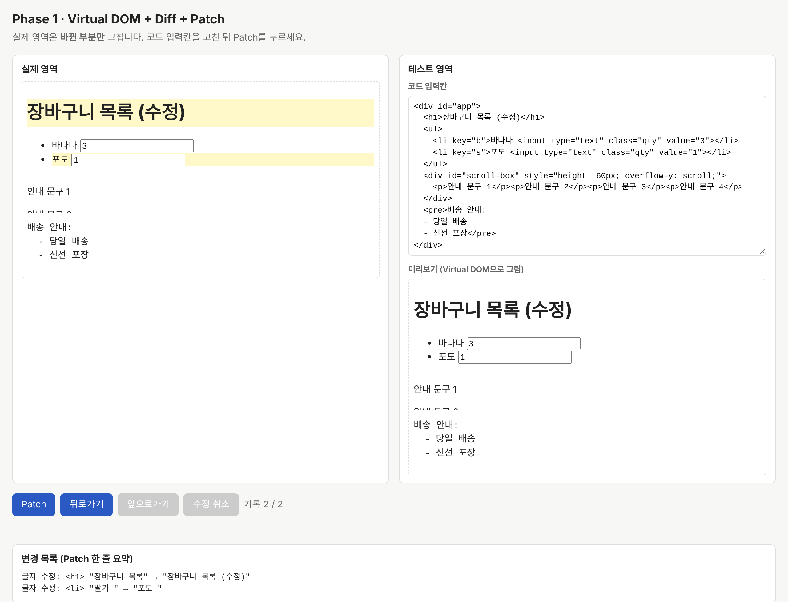
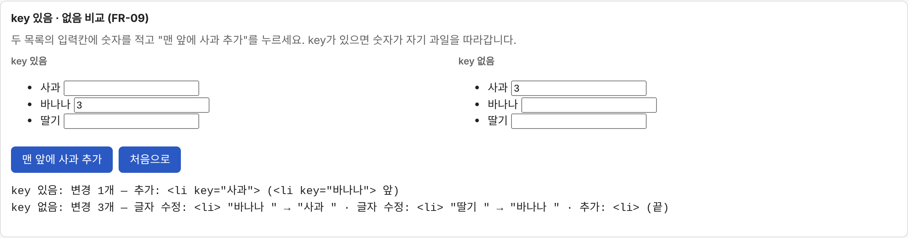
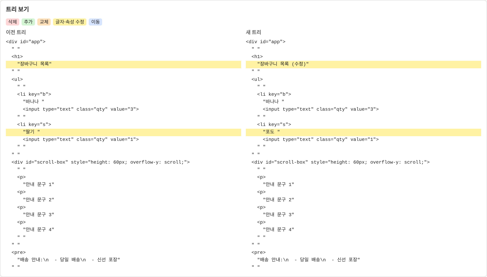
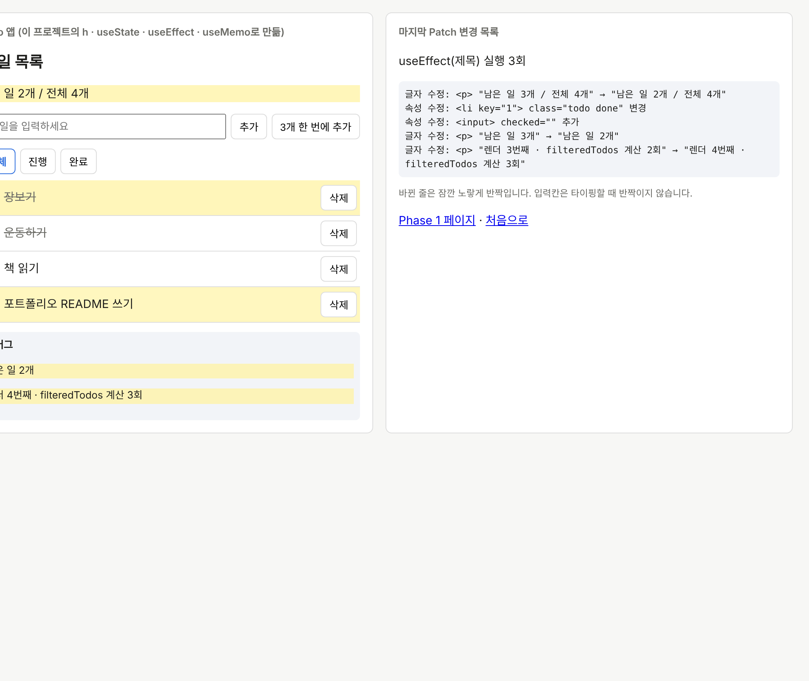
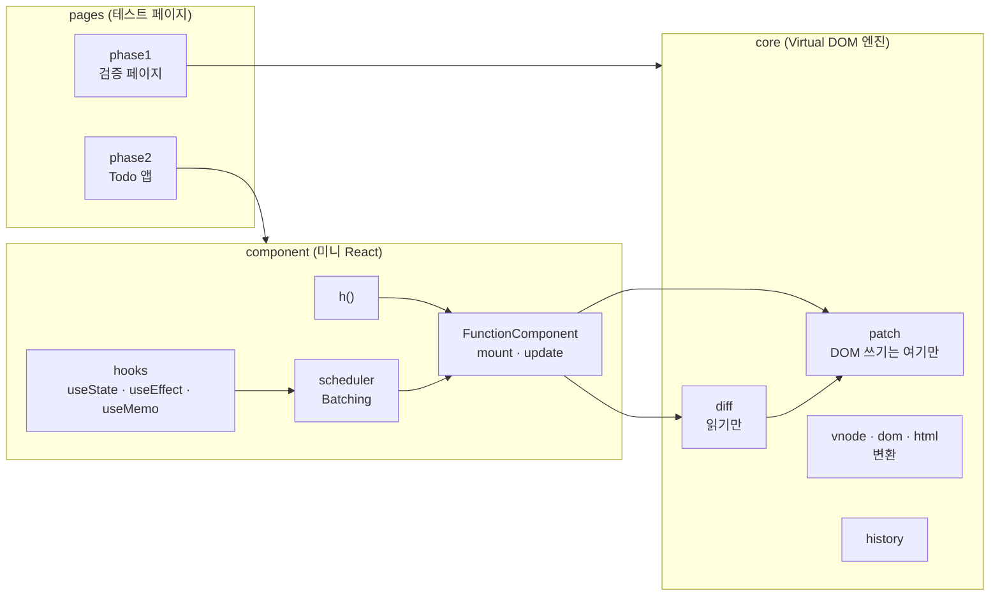

# mini-react

**React 없이 TypeScript로 직접 만든 Virtual DOM 엔진과 Hooks**, 그리고 그 설계를 요구사항부터 테스트까지 끊김 없이 추적하는 **검증 하네스**.

[](https://github.com/team1-mini-lab/mini-react/actions/workflows/verify.yml)
[](https://github.com/team1-mini-lab/mini-react/actions/workflows/pages.yml)

**▶ 데모: https://team1-mini-lab.github.io/mini-react/** — Phase 1 검증 페이지 · Phase 2 Todo 앱

| 테스트 | VT(검증 항목) | 요구사항 추적 | 뮤테이션 점수 | 커버리지 (core · component) | 외부 UI 프레임워크 |
|:---:|:---:|:---:|:---:|:---:|:---:|
| **200 / 200** | **51 / 51** | **44 / 44** | **85.7%** | **97% · 99%** | **0** |

> 숫자는 모두 `scripts/report.py`가 명령 결과로 만든 [검증 보고서](docs/verification/runs/2026-11-11-final-report.md)에서 나온 값입니다. push·PR마다 CI가 다시 계산해 PR 댓글로 올립니다.

---

## 무엇을 만들었나

브라우저의 실제 DOM을 매번 통째로 다시 그리지 않고, **바뀐 부분만** 고치는 React의 핵심 원리를 바닥부터 구현했습니다.

> **Virtual DOM은 만능이 아닙니다.** Virtual DOM을 만들고 비교하는 데에도 비용이 들기 때문에, 항상 더 빠르거나 DOM 변경을 무조건 최소로 만드는 것은 아닙니다. 실제 성능은 UI 구조와 업데이트 방식에 따라 달라집니다. 이 프로젝트가 줄이는 것은 **메인 스레드에서 하는 일**(Batching으로 렌더 횟수, `useMemo`로 재계산)과 **실제 DOM 변경 수**(Diff·Patch)이고, 그 뒤의 Style → Layout → Paint → Composite는 브라우저의 몫입니다. 그래서 성능은 "빠르다"는 주장 대신 DOM 조작 수·렌더 횟수처럼 **셀 수 있는 값**으로 확인합니다.

### Phase 1 — Virtual DOM · Diff · Patch · History



- **Virtual DOM 변환**: 실제 DOM ↔ Virtual DOM ↔ HTML 코드를 오가는 변환기. 공백 규칙(`<pre>` 예외), XSS 정제(`<script>`·`on*`·`javascript:` 제거)
- **Diff**: 이전·새 트리를 비교해 6종 변경(추가·삭제·교체·글자·속성·이동) 목록을 만든다. **key로 자식을 짝지어** 목록 앞에 항목을 넣어도 변경 1개
- **Patch**: 변경만 실제 DOM에 적용. 실제 DOM을 바꾸는 파일은 `core/patch.ts` **하나뿐** (lint로 강제). 실패하면 화면을 새 트리로 복구
- **State History**: 뒤로가기·앞으로가기도 Diff·Patch로 반영. 고친 것 없이 Patch하면 기록하지 않음

| key 있음 · 없음 비교 | 이전 · 새 트리 보기 |
|:---:|:---:|
|  |  |

### Phase 2 — Component · State · Hooks · Batching



- **`h()`**: `h('li', { key, onClick }, ...)`로 화면을 선언. 자식 컴포넌트는 즉시 펼치고, 이벤트는 `attrs`가 아닌 `events`로 분리
- **Hooks**: `useState`, `useEffect`(의존성·정리 함수), `useMemo`. 잘못된 호출(컴포넌트 밖·자식 안·개수 변화)은 실행 중 오류로 잡음
- **Batching**: setState를 여러 번 불러도 `queueMicrotask`로 모아 한 번만 다시 그림. 무한 루프는 50회에서 차단
- **Phase 1 엔진 재사용**: 다시 그릴 때 Phase 1의 `diff`·`applyPatch`를 **수정 없이** 그대로 사용
- **Todo 앱**: 위의 `h`·Hooks만으로 만든 테스트 페이지 (React·JSX 0줄)

### 확장 — 협력적 스케줄링과 성능 실험실 (ADR-0020, 팀 승인 대기)

- **문제**: 렌더링이 동기라 목록이 크면 메인 스레드를 오래 잡는다 (jsdom 측정: 10,000개에서 Diff 약 43ms + Commit 약 57ms)
- **개선**: Diff를 노드 단위 작업(generator)으로 바꿔 `diffSliced()`가 5ms씩 나눠 실행하고 `MessageChannel`로 양보한다. 새 업데이트가 오면 앞 작업을 버리고 최신 상태로 다시 시작한다. 실제 DOM에 반영하는 Commit은 나누지 않는다
- **증명**: 무작위 트리 300쌍에서 동기 Diff와 결과가 같음(fast-check). [성능 실험실](https://team1-mini-lab.github.io/mini-react/src/pages/lab/index.html)에서 동기·협력적·통째 교체를 나란히 돌려 최장 연속 점유(Long Task), 입력 지연, DOM 노드 수를 비교한다
- **한계도 그대로 보여 준다**: Commit은 여전히 동기이고, 전부 바뀌는 변경이면 Patch도 모든 노드를 고친다

---

## 구조



의존 방향은 `pages → component → core` 한 방향이고, `dependency-cruiser`가 역방향 import와 순환을 막습니다. Diff는 실제 DOM(`dom`)과 이벤트(`events`)를 읽지 않아 **실제 DOM 없이 객체 두 개만으로 테스트**할 수 있습니다.

---

## 핵심 설계 결정

모든 결정은 [ADR](docs/adr/README.md)(Architecture Decision Record)로 남겼습니다. 대표적인 것만 추리면:

| 결정 | 왜 | ADR |
|---|---|---|
| 변경 목록은 자리 번호가 아니라 **이전 트리 객체**를 가리키고, Patch는 객체에 기억한 실제 노드(`dom`)로 적용 | 실제 DOM에 주석이 있거나 여러 개를 지우면 번호가 밀린다 | [0004](docs/adr/ADR-0004-diff-patch.md) |
| 자식을 **key**로 짝짓기 | 목록 앞에 끼워 넣어도 입력값이 자기 줄을 따라가고, 조작은 1번 | [0004](docs/adr/ADR-0004-diff-patch.md) |
| 적용 순서: 삭제 → 앞에서부터 [자리 맞추기 → 자신의 변경 → 자식] | 교체를 먼저 하면 그 노드를 기준으로 쓰는 이동이 `insertBefore` 오류를 낸다 | [0005](docs/adr/ADR-0005-patch.md) |
| Patch 실패 시 컨테이너를 새 트리로 통째 복구 | 반쯤 바뀐 화면이 남으면 다음 Patch부터 계속 어긋난다 | [0005](docs/adr/ADR-0005-patch.md) |
| 하이라이트는 `element.animate()` | `class`·`style`을 건드리면 조작 횟수 측정에 섞인다 | [0006](docs/adr/ADR-0006-test-area.md) |
| effect는 React와 같은 순서(정리 함수 전부 → 실행 전부) | 한 effect가 다른 effect의 옛 정리에 기대는 경우(타이머) | [0010](docs/adr/ADR-0010-hooks.md) |
| 이벤트 핸들러는 요소마다 고정 리스너 1개 + `__handlers` 교체 | 매 렌더 새 클로저가 생겨도 DOM 조작 0회 | [0015](docs/adr/ADR-0015-component-rendering.md) |

**실제 React와 의도적으로 다른 점** (발표·방어 포인트): 자식 컴포넌트 즉시 펼침, 요소별 고정 리스너, effect를 Patch 직후 동기 실행, 루트 컴포넌트 하나 & `unmount` 없음, 렌더링 중 setter는 한 번 옛 값으로 그려짐 — 이유는 [SDD Phase 2 1.2](docs/specs/SDD_final_phase2.md)에 있습니다.

---

## 어떻게 검증했나

"테스트가 통과한다"를 넘어, **요구사항 하나하나가 설계·코드·테스트로 이어지는지**를 기계가 확인하게 만들었습니다. 표준은 IEEE 1012(V&V), ISO/IEC/IEEE 29148(요구사항), IEEE 1016(설계 기술)을 참고했습니다.

```
SRS(ID 106개) → ADR(결정 19개) → SDD(설계) → 코드(src) → VT(검증 항목 49개) → 테스트 200개
```

| 관문 | 확인하는 것 | 도구 |
|---|---|---|
| **G1** SRS–SDD 정합성 | 요구사항 ID가 설계 추적표에 빠짐없이 있는지, ADR 테스트 ID가 설계에 반영됐는지, 폐기된 ADR을 근거로 쓰지 않는지 | `check:docs` + 하네스 자체 점검(문서를 12가지로 일부러 망가뜨려 모두 잡는지) |
| **G2** 설계 검증 | 구현 전에 설계를 반례로 공격하고, 모든 반례를 사람이 판정했는지 | AI 반례 검토(Claude·Gemini) + 판정 파일 |
| **G3** 구현 | 타입·구조 규칙 | `tsc --strict`, ESLint(DOM 쓰기는 `patch.ts`만, Diff는 `dom` 읽기 금지), dependency-cruiser, `check:stack`(React 0) |
| **G4** VT 검증 | 테스트·커버리지·**뮤테이션**·VT 증거·요구사항 사슬 | Vitest + jsdom, v8 coverage, Stryker, `check:vt`, `check:trace` |

### 구현 전에 설계 결함을 찾은 사례

설계 문서를 jsdom 시제품으로 먼저 돌려 보는 **설계 반증** 단계에서, 공식 샘플을 **아무것도 고치지 않고 Patch해도 "변경 있음"이 나오는** 결함을 찾았습니다. 원인은 주석을 건너뛴 자리 양옆에 공백 글자 노드가 따로 남아, 실제 영역(자식 15개)과 다시 읽은 트리(자식 9개)가 어긋난 것이었습니다. 이 반례를 ADR-0016(나란히 남은 공백 노드 합치기)으로 고친 뒤 구현해, 무수정 Patch의 변경이 **0개**로 떨어집니다. 같은 방식으로 반례 17건을 판정했고(진짜 반례 8 · 기존 한계 3 · 아님 6), 진짜 반례는 [ADR-0016~0019](docs/adr/README.md)가 되었습니다.

### 뮤테이션 테스트로 테스트의 빈틈 찾기

커버리지가 97%여도 테스트가 결과를 제대로 확인하는지는 알 수 없어서, Stryker로 코드를 980군데 일부러 망가뜨려 봤습니다. 처음 79.4%에서 살아남은 변이(HTML 출력 모양, 체크박스 `checked` 동기화, 이벤트 제거, 50회 경계)를 테스트로 보강해 **85.7%**까지 올렸습니다.

---

## 시작하기

```bash
npm install --legacy-peer-deps
npm run dev          # http://localhost:5173 → Phase 1 / Phase 2 링크
```

| 명령 | 하는 일 |
|---|---|
| `npm test` | Vitest 200개 (jsdom) |
| `npm run test:coverage` | 커버리지 (core·component 90% 미만이면 실패) |
| `npm run test:mutation` | Stryker 뮤테이션 테스트 (약 10분) |
| `npm run verify` | 타입 검사 + 기술 스택 + 의존 방향 + lint + 문서 정합성 + 테스트 |
| `npm run report` | 위 전부를 돌려 `report/REPORT.md`(G1~G4, 정합성 사슬, VT 49개 증거) 생성 |

**기술 스택**: TypeScript 6 (strict) · Vite 8 · Vitest 5 · jsdom · ESLint 10 + typescript-eslint · dependency-cruiser · Stryker · fast-check · GitHub Actions. UI 프레임워크는 쓰지 않습니다.

---

## 폴더

```
src/
  core/         Virtual DOM 엔진: vnode · dom · html · diff · patch · history
  component/    미니 React: h · hooks · scheduler · function-component
  pages/        테스트 페이지: phase1(검증 페이지) · phase2(Todo 앱)
tests/          unit · integration · helpers
scripts/        검증 하네스: check_docs · check_trace · check_vt_tests · check_stack · report · merge_mutation
docs/
  SRS_fixed.md  요구사항 명세 (FR·NFR·IR·CON·VT)
  adr/          설계 결정 기록 ADR-0001~0019
  specs/        설계서 SDD_final_phase1 · phase2 · common
  verification/ 체크리스트, 설계 검토 결과와 판정, 검증 보고서
```

---

## 팀

| 이름 | 주요 기여 |
|---|---|
| 김소망 | Phase 1 핵심 설계 결정 ADR-0001~0006(Virtual DOM 노드, DOM 변환, Diff·Patch, 테스트 영역)과 Phase 2 ADR-0015(컴포넌트 렌더링·이벤트) 작성, 팀 설계 검토(피드백 01~06) |
| 김은기 (velocitygoal) | ADR-0007~0014(언어, History, Batching, Hooks, 테스트·설계 하네스 등) 작성, 하네스 반례 판정으로 ADR-0016~0019 도출, 요구사항(SRS)·최종 설계서(SDD) 정리, Phase 1·2 구현과 테스트 200개, 검증 하네스·CI 보고서·뮤테이션 테스트 |
| Hyunji Lee | 저장소 구성, 설계 결정 검토 |

설계 과정 기록: [미니 리액트 개발 일지](https://eutopiaa.tistory.com/90)
