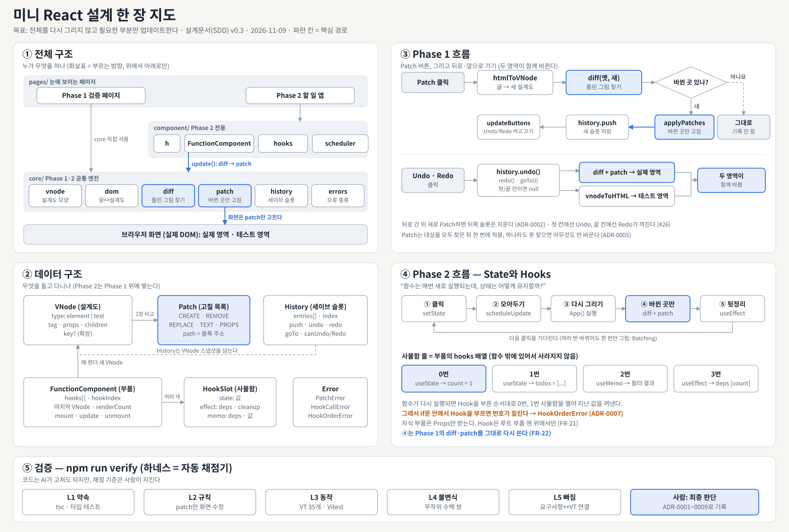

# 미니 React 소프트웨어 설계 문서 (SDD)

2026-11-09 · 프로젝트 팀 (초안: AI, 검토·결정: 팀)

> 한 장 요약은 `SDD_one_page.md`, 결정 이유는 `adr/`.



## 0. 한 장 요약 (쉬운 말)

**최종 목표 (LMS 과제 요구사항)**

- 사용자의 입력·클릭에 따라 **부분 업데이트되는, 실제로 동작하는 웹 페이지**를 만든다.
- 핵심은 **전체를 다시 그리지 않고 필요한 부분만 업데이트**하는 것이다 (3.3, 3.4).
- **뒤로가기·앞으로가기**로 History에 저장된 특정 Virtual DOM으로 이동하고, 그때 **실제 영역과 테스트 영역이 함께** 바뀐다 (3.5, 3.6).
- **"함수는 매번 새로 실행되는데, 상태는 어떻게 유지할까?"** 에 답하는 것이 Hooks의 핵심이다 (4.3).

우리가 만드는 것은 "화면에서 바뀐 곳만 골라서 고치는 도구"다. 화면 전체를 다시 그리면 느리고 입력하던 글자도 사라지기 때문이다. React가 만들어진 이유도 이것이다.

레고 집으로 생각하면 쉽다. 설계도(종이)를 두 장 놓고 틀린 그림을 찾은 다음, 달라진 블록만 갈아끼운다.

| 어려운 말 | 쉬운 비유 | 우리 코드에서 |
| --- | --- | --- |
| 실제 DOM | 실제로 쌓아 올린 레고 집 | 브라우저 화면 |
| Virtual DOM (VNode) | 레고 집의 설계도 (종이 그림) | `VNode` 객체 |
| Diff | 틀린 그림 찾기 | `diff(옛 설계도, 새 설계도)` |
| Patch | 틀린 곳의 블록만 갈아끼기 | `applyPatches` |
| History | 게임 세이브 슬롯 | `History` (Undo = 이전 슬롯, Redo = 다음 슬롯) |
| Component | 모양이 정해진 레고 부품 틀 | `App`, `TodoItem` 같은 함수 |
| Props | 부품에 꼽아 주는 설명서 | 부모가 자식에게 주는 값 |
| State | 점수판처럼 기억해야 하는 값 | `useState` |
| Batching | 장볼 것을 모아서 마트에 한 번만 가기 | 여러 변경을 모아 한 번만 다시 그림 |
| 하네스 | 자동 채점기 | `npm run verify` |
| ADR | "왜 이렇게 정했는지" 적어 둔 일기장 | `docs/adr/` |

우리가 하는 일은 네 단계다.

1. **Phase 1**: 설계도를 비교해 바뀐 곳만 고치고, 세이브 슬롯으로 되돌릴 수 있게 한다 (3장).
2. **Phase 2**: 부품(Component)과 점수판(State)을 넣는다. 점수가 바뀌면 Phase 1 방식 그대로 바뀐 곳만 고친다 (4장).
3. **검증**: 자동 채점기(하네스)가 매번 설계대로 만들었는지 확인한다 (6·8장).
4. **기록**: 중요한 결정은 이유와 함께 ADR에 남긴다. AI가 초안을 쓰고, 결정은 팀이 한다.

그림으로 보려면: 전체 구조는 2장, Patch 버튼 흐름은 3.6, 틀린 그림 찾기 규칙은 3.3, 세이브 슬롯은 3.5, Phase 2 흐름은 4.2, 요구사항 연결은 7.1에 있다.

## 1. 문서 개요

본 문서는 SRS v1.0의 FR-01\~FR-23을 TypeScript(ADR-0001) 모듈과 함수 단위로 구체화하고, VT-01\~VT-35를 실행할 테스트 설계를 정의한다. SRS 3.3.2와 5.2에서 "설계 문서에서 확정"으로 남긴 함수명, 매개변수, 반환 형식, 예외 처리 결과를 이 문서에서 확정한다.

| 항목 | 내용 |
| --- | --- |
| 기준 문서 | SRS v1.0 (2026-11-07), ADR-0001 프로그래밍 언어 선택 (TypeScript) |
| 적용 범위 | Phase 1 (VDOM, 변환, Diff, Patch, History), Phase 2 (Component, Props, State, Hooks), 검증 |
| 문서 상태 | Draft: 1.2의 TBD 제안안은 팀 승인 후 확정 |

### 1.1 TBD 제안안

SRS 6장의 미결 사항에 대해 설계가 전제로 삼는 제안안이다. 팀이 다른 안을 채택하면 표시된 절만 수정하면 된다.

| TBD | 제안안 | 근거 | 영향 절 |
| --- | --- | --- | --- |
| TBD-01 | 분기 시 B, C를 삭제한다 (브라우저 뒤로가기와 동일). | 기록이 단일 선형 배열로 유지되어 Redo 의미가 명확하다. | 3.5 |
| TBD-02 | HTML 코드 입력칸(textarea) + 실시간 미리보기로 수정한다. | contenteditable은 속성·태그 수정이 어렵고, 코드 입력은 FR-02의 태그·속성·글자 변경을 모두 지원한다. | 3.2, 3.6 |
| TBD-03 | CREATE, REMOVE, REPLACE, TEXT, PROPS 5종으로 확정한다. | FR-03\~FR-06과 VT-04, VT-27을 모두 표현할 수 있는 최소 집합이다. | 3.3, 3.4 |
| TBD-04 | 기본은 위치(index) 비교, key는 확장 과제(Should)로 둔다. | 필수 요구사항은 위치 비교로 충족되며, key는 MOVE 패치가 추가되어 복잡도가 크게 오른다. | 3.3 |
| TBD-05 | Batching을 구현한다 (microtask 단위로 한 번 렌더링). | 구현 비용이 작고(스케줄러 20줄 내외) VT-19로 검증 가능하다. | 4.4 |
| TBD-06 | 본 설계 범위 밖. NFR-04가 SRS에 정의되어 있지 않으므로 먼저 SRS에 추가해야 한다. | — | 7.2 |

### 1.2 문서 템플릿과 참고 표준

본 문서의 구성은 IEEE 1016-2009 (Software Design Descriptions)의 설계 관점(viewpoint) 구조를 과제 규모에 맞게 축약한 것이다. SRS가 ISO/IEC/IEEE 29148을 따르므로, 그 다음 단계 문서로 짝을 맞춘다.

| 표준 / 템플릿 | 대상 | 본 문서에서 쓴 부분 |
| --- | --- | --- |
| [IEEE 1016-2009](https://standards.ieee.org/ieee/1016/4502/) Software Design Descriptions | 설계 문서(SDD) | 전체 목차: 구성(2장), 인터페이스·정보(3·4장 타입/함수), 상호작용·상태(렌더 루프, History), 설계 근거(1.1) |
| [ISO/IEC/IEEE 42010:2022](https://www.iso.org/standard/74393.html) Architecture description | 아키텍처 기술 | 2장 모듈 구성과 의존 방향 |
| [ISO/IEC/IEEE 29119-3:2021](https://www.iso.org/standard/79429.html) Test documentation | 테스트 문서 | 6장 테스트 설계·테스트 케이스 양식(입력, 절차, 기대 결과) |
| [ISO/IEC/IEEE 29148:2018](https://www.iso.org/standard/72089.html) Requirements engineering | 요구사항(SRS) | 7장 추적성 (FR ↔ 설계 ↔ VT) |
| [MADR](https://adr.github.io/madr/) Markdown Architectural Decision Records | ADR | ADR-0001 형식. 설계 중 주요 결정(TBD)은 ADR-0002 이후로 남긴다. |

IEEE·ISO 표준 원문은 유료이므로, 본 문서는 목차와 관점 구분만 참고했다. 전체 양식을 그대로 따른 것은 아니다.

### 1.3 GitHub Issue 대응

| Issue | 완료 조건 | 충족하는 절 | 산출물 |
| --- | --- | --- | --- |
| [#10 프로젝트 구조 및 함수 인터페이스 설계](https://github.com/team1-mini-lab/mini-react/issues/10) | 디렉터리 확정, 주요 함수 인터페이스, 모듈 책임 | 2.1, 2.2, 3.2\~3.5, 4.1\~4.4 | 본 문서 2·3·4장, `check:arch` 규칙 (8장) |
| [#11 핵심 자료구조 설계](https://github.com/team1-mini-lab/mini-react/issues/11) | 필드·역할, 관계, Phase 1→2 확장 방향 | 3.1, 3.3, 3.5, 4.2, 4.8 | 본 문서, ADR-0002, ADR-0007 |
| [#12 테스트 환경 구성](https://github.com/team1-mini-lab/mini-react/issues/12) | 환경 실행, 실행 방법 문서화, 기능별 테스트 구조 | 6장, 8장 | ADR-0008, README "테스트 실행" 절 (8.5) |
| [#13 팀 역할 분담 및 설계 문서 작성](https://github.com/team1-mini-lab/mini-react/issues/13) | 담당 확정, 중복·누락 확인, 결정 기록 | 9장, 1.1 | 역할 분담 제안(9장), ADR-0001\~0009 (`docs/adr/`) |

### 1.4 이 문서를 읽는 사람과 궁금한 점

IEEE 1016은 "누가 이 설계에서 무엇을 알고 싶어 하는가"를 먼저 적도록 한다. 각 사람은 오른쪽 열의 절부터 읽으면 된다.

| 읽는 사람 | 궁금한 점 | 먼저 볼 곳 |
| --- | --- | --- |
| 구현 담당 팀원 | 내가 만들 함수의 입력·출력, 다른 모듈과의 약속 | 2장, 부록 A, 9장 |
| 테스트 담당 팀원 | VT를 어떻게 확인하나, 예외는 어떻게 처리하나 | 5·6·8장 |
| 발표자 / 새 팀원 | 전체가 어떻게 돌아가나, 왜 이렇게 정했나 | 0장, 그림 6개, 부록 B |
| 코치 / 평가자 | 요구사항을 다 담았나, 원리를 설명할 수 있나 | 7장, 부록 B·D |
| AI 코딩 도구 | 지켜야 할 규칙과 통과해야 할 검사 | 2장, 8장, `AGENTS.md` |

### 1.5 변경 이력

| 버전 | 날짜 | 바뀐 내용 |
| --- | --- | --- |
| 0.1 | 2026-11-09 | 초안: 1\~7장 (AI 초안) |
| 0.2 | 2026-11-09 | 8장 하네스, 9장 역할 분담, ADR-0002\~0009 추가 |
| 0.3 | 2026-11-09 | 0장 쉬운 요약, 그림 5개, 1.4 읽는 사람, 부록 A\~E 추가 |
| 1.0 | (팀 검토 후) | ADR 승인, SRS 불일치 반영 후 확정 예정 |

## 2. 아키텍처 개요

의존성은 `pages → component → core → DOM` 한 방향으로만 흐른다. core는 component를 모르며, 실제 DOM을 바꾸는 코드는 `core/patch.ts` 한 곳뿐이다 (NFR-03, FR-22).


Phase 1 페이지는 core를 직접 호출하고, Phase 2는 FunctionComponent가 같은 diff·patch를 호출한다. 강조된 두 모듈이 FR-22가 요구하는 공통 경로다.

### 2.1 디렉터리 구조

```text
mini-react/
  src/
    core/
      vnode.ts               VNode 타입, h()
      dom.ts                 domToVNode, htmlToVNode, createElement, vnodeToHTML
      diff.ts                diff, Patch 타입
      patch.ts               applyPatches, setProp
      history.ts             History<T>
      errors.ts              PatchError, HookCallError, HookOrderError
    component/
      h.ts                   컴포넌트 확장 h()
      function-component.ts  FunctionComponent, render()
      hooks.ts               useState, useEffect, useMemo, depsChanged
      scheduler.ts           scheduleUpdate, flushSync
    pages/
      phase1/ index.html, main.ts, init.ts
      phase2/ index.html, main.ts, App.ts
  tests/                     6장 참조
  docs/
    SRS.md
    SDD.md                   본 문서
    adr/  README.md, adr_001~adr_009 (MADR)
```

### 2.2 모듈별 책임

| 모듈 | 책임 | DOM 접근 | 의존 |
| --- | --- | --- | --- |
| vnode | 데이터 타입, VNode 생성 | 없음 | — |
| dom | DOM ↔ VNode 변환 | 읽기, 새 노드 생성 | vnode |
| diff | 두 VNode 비교 → Patch\[\] | 없음 (순수 함수) | vnode |
| patch | Patch\[\]를 실제 DOM에 적용 | 쓰기 (유일) | vnode, dom, errors |
| history | 상태 기록, Undo/Redo 커서 | 없음 | — |
| component/\* | 컴포넌트 실행, Hook 상태, 재렌더 예약 | 없음 (patch 경유) | core |

## 3. Phase 1 설계

Phase 1은 "HTML → VNode → diff → Patch\[\] → 실제 DOM" 한 방향 흐름이며, Undo/Redo도 같은 diff/patch 경로를 재사용한다. 실제 영역을 innerHTML로 통째 교체하는 코드는 초기화 1회 외에는 없다.

### 3.1 Virtual DOM 데이터 구조 (`core/vnode.ts`)

```typescript
export type PropValue = string | number | boolean | EventListener | null;
export type Props = Record<string, PropValue>;

export interface VElement {
  type: 'element';
  tag: string;            // 항상 소문자 ('div', 'li')
  props: Props;           // 속성이 없으면 {}
  children: VNode[];      // 자식이 없으면 []
  key?: string;           // TBD-04 확장용, Phase 1 기본 미사용
}

export interface VText {
  type: 'text';
  text: string;
}

export type VNode = VElement | VText;

export function h(tag: string, props?: Props | null, ...children: (VNode | string)[]): VElement;
```

- `props`와 `children`은 항상 존재한다 (undefined 없음). VT-25, VT-26의 기준이다.
- VNode는 불변(immutable)으로 다룬다. History에 저장된 객체를 수정하지 않는다.

### 3.2 DOM 변환 (`core/dom.ts`)

| 함수 | 입력 → 출력 | 역할 | FR / IR |
| --- | --- | --- | --- |
| `domToVNode(node: Node): VNode \| null` | DOM 노드 → VNode | Element·Text만 변환. 주석과 공백만 있는 Text는 null(제외) | FR-01, IR-04 |
| `htmlToVNode(html: string, rootTag = 'div'): VElement` | HTML 문자열 → 루트 VNode | `DOMParser`로 비활성 문서에서 파싱 후 루트로 감싼다 | FR-02 |
| `createElement(v: VNode): Node` | VNode → 실제 DOM | 새 노드 생성 (CREATE, REPLACE에서 사용) | FR-06 |
| `vnodeToHTML(v: VNode): string` | VNode → HTML | Undo/Redo 후 테스트 영역 textarea 갱신 | FR-08 |

정규화 규칙 (변환 결과와 실제 DOM의 자식 인덱스가 일치해야 path가 동작한다):

1. 주석 노드와 공백만 있는 Text 노드는 제외한다.
2. `on`으로 시작하는 속성과 `<script>`는 제거한다 (입력칸 HTML 실행 방지).
3. 페이지 초기화 시 실제 영역을 `domToVNode`로 변환한 뒤, 그 VNode로 실제 영역을 1회 다시 그린다. 이후 실제 DOM과 VNode의 자식 순서가 항상 일치한다.

### 3.3 Diff (`core/diff.ts`)

```typescript
export type Path = number[];  // 루트로부터의 자식 인덱스 경로, [] = 루트

export type Patch =
  | { type: 'CREATE';  path: Path; node: VNode }        // path = 새 노드가 놓일 위치
  | { type: 'REMOVE';  path: Path }
  | { type: 'REPLACE'; path: Path; node: VNode }
  | { type: 'TEXT';    path: Path; text: string }
  | { type: 'PROPS';   path: Path; set: Props; remove: string[] };

export function diff(oldV: VNode | undefined, newV: VNode | undefined, path?: Path): Patch[];
```

비교 규칙 (같은 path끼리, 깊이 우선):

| 조건 | 결과 | 관련 |
| --- | --- | --- |
| old 없음, new 있음 | CREATE | VT-04 |
| old 있음, new 없음 | REMOVE | VT-04 |
| `type`이 다르거나 `tag`가 다름 | REPLACE (자식 비교 안 함) | FR-06 |
| 둘 다 Text, 내용 다름 | TEXT | FR-05 |
| 둘 다 Element, 속성 다름 | PROPS (바뀐 값은 `set`, 사라진 이름은 `remove`) | FR-05, VT-27 |
| Element 자식 | `0..max(old,new)-1`까지 인덱스별 재귀 | FR-04 |
| 완전히 같음 | 빈 배열 `[]` | VT-28 |

위치 비교이므로 한 부모에서 CREATE는 끝에 추가된 자식, REMOVE는 끝에서 사라진 자식에만 생긴다. 두 종류가 같은 부모에서 동시에 나오지 않는다. 목록 중간 삽입은 "뒤쪽 요소 TEXT/REPLACE + 마지막 CREATE"로 표현되며, 이것이 TBD-04(key)가 해결하려는 문제다.


파란 두 칸(TEXT, PROPS)은 블록을 버리지 않고 내용만 고친다. 그래서 입력하던 글자나 커서가 그대로 남는다 (FR-04, FR-05).

### 3.4 Patch (`core/patch.ts`)

```typescript
export interface PatchResult { applied: number; }
export class PatchError extends Error { constructor(public patch: Patch, message: string); }

export function applyPatches(root: Element, patches: Patch[]): PatchResult;
```

적용은 두 단계로 나뉘어, 인덱스 밀림과 부분 적용을 막는다.

1. **해석(resolve)**: DOM을 바꾸기 전에 모든 패치의 path를 실제 노드 참조로 바꾼다 (CREATE는 부모 노드). 하나라도 없으면 `PatchError`를 던지고 DOM은 전혀 바꾸지 않는다 (VT-31).
2. **적용(apply)**: 참조로 작업하므로 REMOVE 순서에 상관없이 안전하다.

| 패치 | DOM 조작 | 노드 객체 유지 |
| --- | --- | --- |
| CREATE | `parent.appendChild(createElement(node))` | — |
| REMOVE | `target.remove()` | — |
| REPLACE | `target.replaceWith(createElement(node))` | 교체 (FR-06) |
| TEXT | `target.nodeValue = text` | 유지 (FR-05) |
| PROPS | `setProp` / `removeAttribute` | 유지 (FR-05) |

`setProp(el, name, value)` 규칙: `value`, `checked`는 속성이 아닌 프로퍼티로 쓰고, 현재 값과 같으면 쓰지 않는다 (커서 위치 유지, FR-04). `on*` 함수는 Phase 2에서만 쓰며 4.5절을 따른다.

### 3.5 History (`core/history.ts`)

```typescript
export class History<T> {
  constructor(initial: T, limit = 100);
  get current(): T;
  push(state: T): void;   // index 뒤 기록 삭제 후 추가 (TBD-01)
  undo(): T | null;       // 처음이면 null, index 변화 없음
  redo(): T | null;       // 끝이면 null
  goTo(index: number): T | null;  // 특정 기록으로 바로 이동, 범위 밖이면 null
  canUndo(): boolean;
  canRedo(): boolean;
  get size(): number;
}
```

- 초기 상태가 0번 기록이다. Patch를 n번 하면 변경 이력 n개 + 초기 1개, `size === n + 1` (FR-07의 "기록 정책").
- diff 결과가 빈 Patch는 기록하지 않는다 (VT-29). SRS FR-07 문구에 이 예외를 추가해야 한다.
- 한도(100)를 넘으면 가장 오래된 기록부터 버린다.


파란 칸이 지금 화면이다. 첫 칸에서는 Undo가, 마지막 칸에서는 Redo가 꺼진다 (#26). 뒤로 간 다음 새로 Patch하면 그 뒤 칸은 지워진다 (ADR-0002).

### 3.6 Phase 1 검증 페이지 (`pages/phase1`)


위에서 아래로 읽는다. 페이지는 일을 나눠 시키기만 하고, 실제 화면을 만지는 것은 `patch.ts` 하나뿐이다. 점선 화살표는 결과를 돌려주는 것이다.

| UI 요소 | 동작 | FR / IR / VT |
| --- | --- | --- |
| 실제 영역 `#real` | 샘플 HTML(제목, 목록, input, 스크롤 박스 포함). Patch로만 바뀜 | FR-01, VT-33 |
| 테스트 영역 `#editor` (textarea) + `#preview` | 입력할 때마다 미리보기만 갱신, 실제 영역은 그대로 | FR-02, IR-01, VT-34 |
| Patch 버튼 | `next = htmlToVNode(editor)` → `diff(history.current, next)` → `applyPatches` → `history.push` | FR-03, IR-02 |
| Undo / Redo 버튼 | `target = history.undo()` → diff/patch로 실제 영역 갱신 → textarea에 `vnodeToHTML(target)`. 끝에서는 비활성화 | FR-08, IR-03 |
| 기록 표시 `2 / 4` | 현재 index / 전체 | FR-07 |
| Patch 로그 | 마지막 Patch\[\]를 JSON으로 표시 | VT-05, 시연용 |

## 4. Phase 2 설계

State는 루트 컴포넌트 하나만 가지고, 자식은 Props만 받는 순수 함수다 (FR-15, FR-21). State가 바뀌면 루트를 다시 실행해 새 VNode를 만들고, Phase 1의 `diff` + `applyPatches`로만 화면을 바꾼다 (FR-22).

### 4.1 컴포넌트와 VNode 생성 (`component/h.ts`)

```typescript
export type Component<P = {}> = (props: P & { children?: VNode[] }) => VElement;

// Phase 1의 h를 확장: tag가 함수면 자식 컴포넌트로 즉시 실행해 VNode로 펼친다
export function h<P>(tag: string | Component<P>, props?: P | null, ...children: (VNode | string)[]): VElement;
```

- 자식 컴포넌트는 `h(TodoItem, { todo, onToggle })`로 호출되며, `h` 내부에서 `renderingChild` 카운터를 올리고 실행한다. 이 카운터가 0보다 크면 Hook 호출은 오류다 (4.6).
- 결과 VNode에는 함수가 남지 않는다. diff는 Phase 1과 동일하게 순수 VNode만 비교한다.
- 선택사항: JSX를 쓰려면 `tsconfig`의 `jsxFactory: "h"`로 연결한다. 쓰지 않아도 동작은 같다.

### 4.2 FunctionComponent (`component/function-component.ts`)

```typescript
type HookSlot =
  | { kind: 'state';  value: unknown }
  | { kind: 'effect'; deps?: unknown[]; cleanup?: () => void; pending?: () => void | (() => void) }
  | { kind: 'memo';   deps: unknown[]; value: unknown };

export class FunctionComponent<P> {
  hooks: HookSlot[] = [];
  hookIndex = 0;
  renderCount = 0;          // VT-19 검증용
  private vnode: VElement | null = null;

  constructor(private fn: Component<P>, private props: P, private container: Element);
  mount(): void;            // 최초 렌더 + createElement + effect 실행
  update(): void;           // 재렌더 + diff + applyPatches + effect 실행
  unmount(): void;          // 모든 effect cleanup 실행 후 DOM 비움
}

export function render<P>(fn: Component<P>, props: P, container: Element): FunctionComponent<P>;
```

렌더 한 번의 순서 (`mount`와 `update` 공통):

1. `currentComponent = this`, `hookIndex = 0`
2. `next = fn(props)` 실행. Hook은 `hooks[hookIndex++]`를 읽고 쓴다.
3. 호출된 Hook 개수가 이전 렌더와 다르면 `HookOrderError` (4.6)
4. `currentComponent = null`
5. mount: `container.appendChild(createElement(next))` / update: `applyPatches(container, diff(this.vnode, next))`
6. `this.vnode = next`, `renderCount++`
7. pending effect를 순서대로: 이전 cleanup 실행 → effect 실행 → 반환값을 cleanup으로 저장 (FR-18)


파란 칸(④)이 Phase 1에서 만든 diff와 patch를 그대로 다시 쓰는 자리다 (FR-22). ②에서 변경을 모아 두기 때문에 버튼 한 번에 값이 여러 개 바뀌어도 ③\~⑤는 한 번만 돈다 (ADR-0006).

### 4.3 Hooks (`component/hooks.ts`)

```typescript
export type SetState<T> = (next: T | ((prev: T) => T)) => void;

export function useState<T>(initial: T | (() => T)): [T, SetState<T>];
export function useEffect(effect: () => void | (() => void), deps?: unknown[]): void;
export function useMemo<T>(factory: () => T, deps: unknown[]): T;

// 공통: 이전 deps가 없거나, 길이가 다르거나, 하나라도 Object.is로 다르면 true
export function depsChanged(prev: unknown[] | undefined, next: unknown[] | undefined): boolean;
```

| Hook | 최초 렌더 | 재렌더 | FR / VT |
| --- | --- | --- | --- |
| `useState` | `initial`(함수면 실행 결과)을 슬롯에 저장, `[value, setter]` 반환 | 슬롯 값 반환. setter는 컴포넌트·인덱스에 묶인 같은 함수 | FR-16, VT-12 |
| setter | — | 새 값 계산(함수면 `prev`로 실행) → `Object.is`로 같으면 무시 → 다르면 저장 후 `scheduleUpdate` | FR-17, VT-13 |
| `useEffect` | effect를 pending에 등록 | `deps` 없음: 매번 등록 / `[]`: 등록 안 함 / 그 외: `depsChanged`일 때만 등록 | FR-18, FR-19, VT-14 |
| `useMemo` | `factory()` 결과와 deps 저장 | `depsChanged`면 재계산, 아니면 저장된 값 반환 | FR-20, VT-15 |

Effect는 Patch 직후 동기적으로 실행한다. React는 페인트 이후 비동기로 실행하나, 테스트를 단순하게 하려고 단순화했다.

**"함수는 매번 새로 실행되는데, 상태는 어떻게 유지할까?"** (LMS 핵심 질문)

부품 함수 안의 변수는 함수가 끝나면 사라진다. 그래서 값을 함수 밖, 부품마다 하나씩 있는 사물함 줄(`hooks` 배열)에 넣어 둔다. 함수가 다시 실행되면 `useState`를 부른 **순서**대로 1번 사물함, 2번 사물함을 열어 지난 값을 꺼낸다.

1. 처음 실행: `useState(0)` → 1번 사물함에 0을 넣고 0을 돌려준다.
2. 버튼 클릭: setter가 1번 사물함 값을 1로 바꾸고 다시 그리기를 예약한다.
3. 다시 실행: `useState(0)`을 또 부르지만, 1번 사물함에 이미 1이 있으므로 초기값 0은 무시하고 1을 돌려준다.

사물함을 "번호(순서)"로 찾기 때문에 Hook을 if문 안에서 부르면 번호가 밀려 다른 값을 꺼내게 된다. 이것이 Hook 호출 규칙(4.6, FR-21)이 필요한 이유다.

### 4.4 스케줄러와 Batching (`component/scheduler.ts`, TBD-05)

```typescript
export function scheduleUpdate(c: FunctionComponent<any>): void {
  dirty.add(c);
  if (!flushQueued) { flushQueued = true; queueMicrotask(flush); }
}
function flush(): void { flushQueued = false; for (const c of dirty) c.update(); dirty.clear(); }
export function flushSync(): void;   // 테스트용: 대기 중인 업데이트 즉시 실행
```

- 한 이벤트 핸들러에서 setter를 3번 호출해도 microtask 한 번에 `update()` 1회, `renderCount`는 1 증가 (VT-19).
- 렌더 중 setter 호출은 다음 microtask로 미루고 `console.warn`을 남긴다. 무한 루프 방지를 위해 연속 50회를 넘으면 오류를 던진다.
- TBD-05에서 Batching을 하지 않기로 하면 `scheduleUpdate`에서 `c.update()`를 바로 부르도록 한 줄만 바꾼다.

### 4.5 이벤트 처리

매 렌더마다 핸들러가 새 클로저로 만들어져 PROPS 패치가 매번 생긴다. 리스너를 매번 떼고 붙이지 않도록, 요소마다 고정 리스너 하나를 두고 참조만 바꾼다.

- `setProp(el, 'onClick', fn)`: `el.__handlers.click = fn`. 처음일 때만 `addEventListener('click', dispatch)`.
- `removeProp(el, 'onClick')`: `delete el.__handlers.click`, 리스너 제거.
- 함수끼리는 diff에서 참조 비교한다. 다르면 PROPS로 나오지만 DOM 업데이트는 발생하지 않는다 (NFR-01 측정 시 MutationObserver에 잡히지 않음).

### 4.6 Hook 호출 규칙 검사 (FR-21)

| 위반 | 감지 방법 | 결과 |
| --- | --- | --- |
| 컴포넌트 밖에서 호출 | `currentComponent === null` | `HookCallError` |
| 자식 컴포넌트에서 호출 | `renderingChild > 0` | `HookCallError` |
| 조건문·반복문 안에서 호출 (호출 수 변화) | 렌더 후 `hookIndex !== hooks.length` | `HookOrderError` |
| 순서 변경 (같은 인덱스의 종류 불일치) | `hooks[i].kind !== 요청 kind` | `HookOrderError` |

개수와 종류가 우연히 같은 조건부 호출은 런타임에 잡을 수 없다. 이 한계는 코드 리뷰(VT-22) 항목으로 보완한다.

### 4.7 Phase 2 테스트 페이지 (`pages/phase2`, FR-23)

할 일 목록 앱으로, 각 화면 요소가 하나의 검증 항목을 보여 준다.

| 컴포넌트 | 역할 | 사용 Hook / Props | VT |
| --- | --- | --- | --- |
| `App` (루트) | `todos`, `input`, `filter` State 소유 | useState ×3, useMemo(필터 결과, 통계), useEffect(`document.title`, 로그) | VT-12\~VT-15 |
| `TodoInput` | 입력칸 + 추가 버튼 | Props: `value`, `onInput`, `onAdd` | VT-11, VT-18 |
| `TodoList` / `TodoItem` | 목록, 완료 토글, 삭제 | Props: `todos`, `onToggle`, `onRemove` | VT-11, VT-17 |
| `FilterBar` | 전체/진행/완료 | Props: `filter`, `onChange` | VT-15 |
| `DebugPanel` | renderCount, memo 재계산 횟수, effect 로그, 마지막 Patch\[\] | Props: `stats` | VT-17, VT-19 |
| "한 번에 3개 추가" 버튼 | setter 3회 호출 | — | VT-19 |

### 4.8 자료구조 관계와 Phase 1 → 2 확장

| 자료구조 | 소유자 | 참조하는 것 | Phase 2에서 달라지는 점 |
| --- | --- | --- | --- |
| `VNode` | 페이지(Phase 1), `FunctionComponent.vnode`(Phase 2) | 자식 `VNode[]` | `PropValue`에 `EventListener` 추가. 타입 자체는 그대로 |
| `Patch[]` | diff가 만들고 즉시 소비 | `Path`, `VNode` | 변화 없음 (FR-22) |
| `History<VNode>` | Phase 1 페이지 | `VNode` 스냅샷 | Phase 2에서는 사용 안 함 (제네릭이라 State 기록에 재사용 가능) |
| `FunctionComponent` | `render()` 호출자 | `Component` 함수, `HookSlot[]`, 마지막 `VNode`, 컨테이너 | Phase 2 신규 |
| `HookSlot` | `FunctionComponent.hooks` | State 값, effect deps·cleanup, memo 값 | Phase 2 신규 |

핵심은 Phase 2가 Phase 1 자료구조를 바꾸지 않고 위에 쌓는다는 점이다. `FunctionComponent`는 매 렌더마다 `HookSlot[]`을 읽어 새 `VNode`를 만들고, 이전 `VNode`와의 `Patch[]`로만 DOM을 바꾼다.

## 5. 예외 처리 및 경계 조건

원칙은 "프로그래머 오류는 던지고, 사용자 입력은 관대하게"다. 잘못된 인자나 Hook 규칙 위반은 오류를 던지고, 사용자가 입력한 HTML과 버튼 조작은 오류 없이 처리한다. 이 표가 SRS VT-21, VT-25\~VT-31의 "정의된 처리 결과"다.

| 상황 | 모듈 | 정의된 처리 결과 | VT |
| --- | --- | --- | --- |
| 자식이 없는 요소 변환 | dom | `children: []` | VT-25 |
| 속성이 없는 요소 변환 | dom | `props: {}` | VT-26 |
| `domToVNode(null)` 또는 Node가 아닌 값 | dom | `TypeError` | VT-21 |
| 주석, 공백만 있는 Text | dom | 변환에서 제외 (`null`) | VT-21 |
| 닫히지 않은 태그 등 잘못된 HTML | dom | DOMParser가 교정한 구조를 그대로 사용, 오류 없음 | VT-21 |
| 빈 테스트 영역 | dom | 자식 없는 루트. Patch 시 실제 영역의 자식 모두 REMOVE | VT-21 |
| `on*` 속성, `<script>` 입력 | dom | 제거 후 변환 | VT-21 |
| 기존 속성 삭제 | diff | `PROPS.remove`에 속성 이름 기록 | VT-27 |
| 동일한 VNode 비교 | diff | `[]` | VT-28 |
| 같은 내용으로 Patch | page | DOM 변경 0건, History 추가 없음, "변경 사항 없음" 표시 | VT-29 |
| 기록이 하나뿐일 때 Undo/Redo | history | `null` 반환, index와 화면 변화 없음, 버튼 비활성 | VT-30 |
| 존재하지 않는 path에 대한 패치 | patch | `PatchError`, DOM 변경 0건 (적용 전 전체 검사) | VT-31 |
| 루트(path `[]`) REPLACE/REMOVE | patch | `PatchError` (실제 영역 컨테이너는 고정) | VT-31 |
| 컴포넌트 밖 / 자식에서 Hook 호출 | hooks | `HookCallError` | VT-16 |
| 렌더마다 Hook 개수·종류 변화 | hooks | `HookOrderError` | VT-16 |
| setter에 이전과 같은 값 | hooks | 재렌더 없음 (`renderCount` 변화 없음) | VT-13 |
| unmount 후 setter 호출 | hooks | 무시 + `console.warn` | VT-21 |
| effect 함수 안에서 오류 | component | 다른 effect는 계속 실행, 오류는 `console.error` | VT-21 |
| 렌더 중 setter 연속 50회 초과 | scheduler | `Error('Too many re-renders')` | VT-21 |

오류 클래스는 `core/errors.ts`에 모아 둔다: `PatchError`, `HookCallError`, `HookOrderError`. 테스트는 메시지가 아니라 클래스로 판별한다 (`toThrow(PatchError)`).

## 6. 검증 설계

Unit·Integration·Boundary 테스트는 Vitest + jsdom으로 자동 실행하고, Functional 테스트는 검증 페이지에서 체크리스트로 수행한다. 하나의 VT는 하나 이상의 `it()` 또는 체크리스트 항목에 대응하며, 테스트 이름에 VT ID를 붙인다.

### 6.1 테스트 환경 (CON-05, VT-35)

| 항목 | 선택 | 비고 |
| --- | --- | --- |
| 빌드 / 개발 서버 | Vite + TypeScript (`strict: true`) | ADR-0001의 컴파일 환경 |
| 테스트 러너 | Vitest | Vite 설정 공유, `npm test` |
| DOM 환경 | jsdom (`environment: 'jsdom'`) | DOMParser, MutationObserver 지원 |
| 커버리지 | `@vitest/coverage-v8` | 목표는 core/component 모듈 구문 80% (팀 확정 필요) |
| Functional (선택) | Playwright | 체크리스트 자동화를 원할 때만 |

jsdom은 레이아웃을 계산하지 않는다. 스크롤 위치 유지(FR-04)는 Functional 테스트로만 확인한다.

### 6.2 테스트 구조

```text
tests/
  unit/
    dom.test.ts           VT-01, VT-02, VT-25, VT-26
    diff.test.ts          VT-03~VT-05, VT-27, VT-28
    patch.test.ts         VT-31
    history.test.ts       VT-30, History 단위
    hooks.test.ts         VT-12, VT-14~VT-16
    component.test.ts     VT-10, VT-11
  integration/
    phase1.test.ts        VT-06, VT-07, VT-20, VT-29
    phase2.test.ts        VT-13, VT-17, VT-19
  helpers/
    mutation-counter.ts   MutationObserver로 DOM 변경 건수 측정
    tag-nodes.ts          Patch 전 노드에 표식을 달고 동일 객체 여부 확인
docs/functional-checklist.md   VT-08, VT-09, VT-18, VT-24, VT-32~VT-34
```

### 6.3 핵심 측정 기법

- **동일 객체 확인 (FR-04, FR-05)**: Patch 전 `const before = getNode(root, path)`, Patch 후 `expect(getNode(root, path)).toBe(before)`.
- **불필요한 업데이트 측정 (NFR-01, VT-20)**: `MutationObserver`로 기록을 모아, 변경된 노드 외의 대상이 0건인지 확인한다.
- **구조 일치 (FR-03)**: `expect(domToVNode(real)).toEqual(htmlToVNode(editorValue))`.
- **렌더 횟수 (VT-19)**: `component.renderCount`를 클릭 전후로 비교, `await Promise.resolve()` 또는 `flushSync()` 후 확인.

### 6.4 테스트 케이스 (자동)

| VT | 방법 | 입력 / 절차 | 기대 결과 |
| --- | --- | --- | --- |
| VT-01 | Unit | `<div id="a"><p>hi</p></div>` → `domToVNode` | `{tag:'div', props:{id:'a'}, children:[{tag:'p', children:[{type:'text', text:'hi'}]}]}` |
| VT-02 | Unit | Element, Text, 주석, 공백 Text가 섞인 노드 | Element·Text만 변환, 주석·공백 제외 |
| VT-03 | Unit | `<p>a</p>` vs `<p>b</p>` | `[{type:'TEXT', path:[0], text:'b'}]` |
| VT-04 | Unit | 추가·삭제·태그 변경·속성 변경 4건을 각각 | CREATE, REMOVE, REPLACE, PROPS 한 건씩 |
| VT-05 | Unit | VT-04의 각 결과 | `path`와 `node`/`set`/`remove` 값이 기대값과 일치 |
| VT-06 | Integration | 3개 문단 중 2번째만 글자 변경 후 Patch | 1·3번째 노드 동일 객체, 2번째 `nodeValue`만 변경 |
| VT-07 | Integration | Patch 3회 | `history.size === 4`, `history.current`가 마지막 입력과 `toEqual` |
| VT-10 | Unit | `render(App, {}, el)` 후 `update()` | mount 후 DOM 생성, update 후 `renderCount === 2` |
| VT-11 | Unit | `App`이 `h(Child, {name:'kim'})` | 자식 출력에 `kim` |
| VT-12 | Unit | `useState(5)`, `useState(() => 7)` | 값 5, 7, setter는 함수 |
| VT-13 | Integration | 클릭 → `setCount(c => c + 1)` | 화면 `1`, `setCount(1)` 다시 하면 renderCount 변화 없음 |
| VT-14 | Unit | deps 없음 / `[]` / `[a]` 각각 렌더 3회, `a`는 2회차에만 변경 | effect 실행 3회 / 1회 / 2회, cleanup은 다음 실행 직전 |
| VT-15 | Unit | `useMemo(spy, [a])`, a 그대로 → 변경 | spy 호출 1회 → 2회 |
| VT-16 | Unit | 컴포넌트 밖 호출, 자식 호출, 조건부 호출 | `HookCallError`, `HookCallError`, `HookOrderError` |
| VT-17 | Integration | `diff`, `applyPatches`에 spy 후 State 변경 | 두 함수 각 1회 호출, `innerHTML` 대입 없음 |
| VT-19 | Integration | 한 핸들러에서 setter 3회 | renderCount +1, 화면에 3건 모두 반영 |
| VT-20 | Integration | 10개 항목 중 1개 속성 변경 | MutationRecord 1건 (attributes) |
| VT-25\~VT-31 | Boundary | 5장 표의 각 행 | 5장 "정의된 처리 결과"와 일치 |
| VT-35 | Env Check | `npm test` | jsdom 환경에서 전체 통과, CI 로그 확인 |

### 6.5 Functional 체크리스트 (수동)

- [ ] VT-32: Phase 1 페이지에 실제 영역, 테스트 영역, Patch, Undo, Redo가 보인다.
- [ ] VT-33: 최초 실행 시 두 영역의 내용이 같다.
- [ ] VT-34: textarea를 고쳐도 Patch 전에는 실제 영역이 그대로다.
- [ ] FR-04: 실제 영역 input에 글자를 입력하고 다른 문단만 바꾼 뒤 Patch하면 입력값·스크롤이 유지된다.
- [ ] VT-08: Patch 2회 후 Undo → 두 영역이 1회차 상태다.
- [ ] VT-09: 이어서 Redo → 두 영역이 2회차 상태다.
- [ ] VT-18: Phase 2 페이지에서 추가·토글·삭제·필터가 즉시 화면에 반영된다.
- [ ] VT-24: Chrome 최신 버전에서 두 페이지 모두 콘솔 오류 없이 동작한다.
- [ ] VT-22, VT-23: 코드 리뷰에서 모듈 의존 방향(2장)과 `package.json`에 UI 프레임워크 없음을 확인한다.

## 7. 추적성 및 미결 사항

### 7.1 FR ↔ 설계 ↔ VT


요구사항 하나가 설계, 검사, 할 일(이슈), 결정 이유(ADR)까지 끊김 없이 이어져야 한다. Phase 2 이슈 번호는 아직 확인하지 못해 빈칸으로 두었다.

| FR | 설계 요소 | 절 | VT |
| --- | --- | --- | --- |
| FR-01 | `domToVNode`, 초기화 재렌더 | 3.2 | VT-01, VT-33 |
| FR-02 | textarea + `htmlToVNode` | 3.2, 3.6 | VT-02, VT-34 |
| FR-03 | Patch 버튼 흐름 | 3.6 | VT-03, VT-06 |
| FR-04 | index diff, resolve→apply, `setProp` 값 비교 | 3.3, 3.4 | VT-04, VT-06, VT-20 |
| FR-05 | TEXT, PROPS 패치 | 3.3, 3.4 | VT-05, VT-27 |
| FR-06 | REPLACE 패치 | 3.3, 3.4 | VT-04 |
| FR-07 | `History.push` | 3.5 | VT-07, VT-29 |
| FR-08 | `History.undo/redo` + diff/patch | 3.5, 3.6 | VT-08, VT-09, VT-30 |
| FR-11, FR-12 | `FunctionComponent.mount/update` | 4.2 | VT-10 |
| FR-13, FR-15 | `h(Component, props)`, 루트 전용 State | 4.1 | VT-11 |
| FR-14, FR-17 | setter → `scheduleUpdate` → `update` | 4.3, 4.4 | VT-13 |
| FR-16 | `useState` | 4.3 | VT-12 |
| FR-18, FR-19 | `useEffect`, `depsChanged` | 4.3 | VT-14 |
| FR-20 | `useMemo` | 4.3 | VT-15 |
| FR-21 | `HookCallError`, `HookOrderError` | 4.6 | VT-16 |
| FR-22 | `update()` 내부 `diff` + `applyPatches` | 4.2 | VT-17 |
| FR-23 | 할 일 목록 테스트 페이지 | 4.7 | VT-18 |
| TBD-05 | `scheduler.ts` | 4.4 | VT-19 |

### 7.2 SRS에 반영할 항목

설계 중 SRS v1.0에서 발견한 불일치다. 다음 SRS 개정(v1.1)에서 고치는 것을 제안한다.

- [ ] 4.2절 VT-02\~VT-06의 "요구사항 ID"가 내용과 맞지 않는다. 예: VT-02(노드 변환)는 FR-02(테스트 영역 수정)가 아니라 FR-01, VT-03\~VT-05(Diff)는 FR-03\~FR-05가 아니라 FR-04\~FR-06에 대응한다. 7.1 표를 기준으로 재매핑을 제안한다.
- [ ] TBD-06이 참조하는 NFR-04가 3.2.1에 없다. 추가하거나 참조를 삭제한다.
- [ ] FR-07에 "변경 사항이 없는 Patch는 기록하지 않는다"를 추가한다 (3.5, VT-29와 일치).
- [ ] FR-11\~FR-23에 인수 기준·검증 열이 없다. Phase 1 표와 같은 형식으로 맞춘다.
- [ ] 5.1.2의 R1\~R16 매핑을 원본 과제 문서에서 채운다.
- [ ] 1.1의 TBD 제안안을 팀이 결정하면 각각 ADR-0002 이후로 기록한다 (예: ADR-0002 History 분기 정책, ADR-0003 Batching).

### 7.3 남은 설계 결정

- 커버리지 목표치 (6.1에는 80%를 제안값으로 적음)
- key 기반 비교(TBD-04)를 구현할 경우 MOVE 패치 설계를 3.3에 추가
- 성능 목표(SRS 3.2.2): 측정한다면 1,000개 노드 diff 시간 등 기준 정의 필요

## 8. 설계 검증 하네스

본 설계의 규칙을 실행 가능한 검사로 바꾸어, 모든 PR에서 `npm run verify` 하나로 설계 준수 여부를 판정한다 (ADR-0009). 팀원이 짠 코드든 AI 코딩 도구가 짠 코드든 같은 검사를 통과해야 병합된다.

### 8.1 하네스가 검증하는 것과 못 하는 것

하네스는 "코드가 설계대로 만들어졌는가(준수)"를 검증한다. "설계가 옳은가(타당성)"는 검증하지 못하므로 ADR과 팀 리뷰로 다룬다.

| 구분 | 예 | 방법 |
| --- | --- | --- |
| 기계 판정 가능 | 의존 방향, 함수 시그니처, DOM 쓰기 위치, diff/patch 불변식, Hook 규칙, VT 추적성 | 하네스 (8.2) |
| 사람의 판단 필요 | Patch 유형이 충분한가, 모듈 경계가 적절한가, 이름이 명확한가 | ADR 작성 + 설계 리뷰 |
| 하네스 자체의 신뢰도 | 테스트가 실제 버그를 잡는가 | 뮤테이션 테스트 (8.2 L7, 선택) |

### 8.2 하네스 구성 (7계층)

| 계층 | 검사하는 설계 규칙 | 도구 | 명령 | 근거 절 | 우선순위 |
| --- | --- | --- | --- | --- | --- |
| L1 타입 계약 | 3·4장의 함수 시그니처와 타입이 코드와 같다 | `tsc --noEmit` (strict), Vitest `expectTypeOf` | `typecheck` | 3.1\~3.5, 4.1\~4.3 | Must |
| L2 아키텍처 규칙 | core→component 금지, DOM 쓰기는 patch.ts만, UI 프레임워크 의존 없음 | dependency-cruiser, ESLint | `check:arch` | 2.2, VT-22, VT-23 | Must |
| L3 동작 명세 | VT-01\~VT-35의 기대 결과 | Vitest + jsdom | `test` | 6.4, 5장 | Must |
| L4 불변식 | 임의 입력에 대해 설계가 보장하는 성질 (8.3) | fast-check | `test` (포함) | 3.3\~3.5, 4.3 | Must |
| L5 추적성 | SRS의 모든 VT가 테스트 또는 체크리스트에 있고, 그 반대도 성립 | `scripts/check-trace.ts` | `check:trace` | 7.1 | Must |
| L6 브라우저 E2E | 스크롤·커서 유지, 페이지 UI | Playwright | `test:e2e` | 6.5 | Should |
| L7 하네스 검증 | 테스트가 인위적 버그를 잡는가 | Stryker | `test:mutation` | — | Could |

### 8.3 L4 불변식: 설계를 가장 강하게 검증하는 층

예시 입력 몇 개로는 놓치는 경우를 잡기 위해, 무작위 VNode 트리 수백 쌍으로 설계가 약속한 성질을 확인한다.

| 불변식 | 의미 | 설계 근거 |
| --- | --- | --- |
| `domToVNode(patch(render(a), diff(a, b))) ≡ b` | Patch 후 실제 DOM이 새 VNode와 같다 | FR-03, ADR-0004 |
| `diff(a, a) = []` | 변경이 없으면 패치도 없다 | VT-28 |
| a와 b에서 같은 path의 태그가 같으면 Patch 후 그 노드는 같은 객체 | 바뀜 요소만 교체된다 | FR-04, FR-05 |
| 잘못된 path가 섞이면 DOM 변경 0건 | Patch는 원자적이다 | ADR-0005 |
| push n회 후 undo n회 → 초기 상태, redo n회 → 마지막 상태 | History 이동이 가역적이다 | FR-08, ADR-0002 |
| 같은 deps로 k회 렌더 → useMemo factory 1회 | 계산 결과를 재사용한다 | FR-20 |
| 한 microtask 안 setter m회 → renderCount +1 | Batching | ADR-0006 |

```typescript
// tests/property/diff-patch.prop.test.ts
import fc from 'fast-check';
import { arbVNode } from '../helpers/arb-vnode'; // 무작위 VNode 생성기 (깊이 4, 자식 0~4)

it('[VT-03][INV-1] patch(render(a), diff(a, b))는 b와 같다', () => {
  fc.assert(fc.property(arbVNode(), arbVNode(), (a, b) => {
    const root = mountRoot(a);                 // 루트 div 아래에 a를 그린다
    applyPatches(root, diff(wrap(a), wrap(b)));
    expect(domToVNode(root)).toEqual(wrap(b));
  }), { numRuns: 300 });
});
```

### 8.4 L2 아키텍처 규칙 예시

```javascript
// .dependency-cruiser.cjs — 2장 의존 방향을 기계 규칙으로
module.exports = { forbidden: [
  { name: 'core-is-independent', severity: 'error',
    from: { path: '^src/core' }, to: { path: '^src/(component|pages)' } },
  { name: 'component-not-pages', severity: 'error',
    from: { path: '^src/component' }, to: { path: '^src/pages' } },
  { name: 'no-circular', severity: 'error', from: {}, to: { circular: true } },
  { name: 'no-ui-framework', severity: 'error',
    from: {}, to: { path: 'node_modules/(react|react-dom|vue|preact|svelte)/' } },
]};
```

```javascript
// eslint.config.js — "DOM을 바꾸는 코드는 patch.ts 한 곳" (2장, FR-22)
{
  files: ['src/**/*.ts'],
  ignores: ['src/core/patch.ts', 'src/core/dom.ts', 'src/pages/*/init.ts'],
  rules: { 'no-restricted-syntax': ['error',
    { selector: "CallExpression[callee.property.name=/^(appendChild|removeChild|replaceWith|insertBefore|remove|setAttribute|removeAttribute)$/]",
      message: 'DOM 변경은 core/patch.ts의 applyPatches를 통해서만 한다 (SDD 2장).' },
    { selector: "AssignmentExpression[left.property.name=/^(innerHTML|outerHTML|textContent|nodeValue)$/]",
      message: 'innerHTML 등 직접 대입 금지 (SDD 3장). 초기화는 pages/*/init.ts에서만 허용.' },
  ]},
}
```

규칙 메시지에 설계 문서 절 번호를 넣는다. 위반한 사람(또는 AI 도구)이 오류 메시지만 보고 무엇을 고쳐야 하는지 알 수 있다.

### 8.5 L5 추적성 검사와 실행 방법

`scripts/check-trace.ts`는 `docs/SRS.md`에서 `VT-\d+`를 모으고, `tests/**`의 테스트 이름 `[VT-xx]`과 `docs/functional-checklist.md`의 항목을 모아 비교한다. SRS에만 있는 VT(미검증)나 테스트에만 있는 VT(오타)가 있으면 실패한다. VT-19는 ADR-0006이 accepted일 때만 필수다.

```json
"scripts": {
  "typecheck":   "tsc --noEmit",
  "lint":        "eslint .",
  "check:arch":  "depcruise src",
  "test":        "vitest run",
  "check:trace": "tsx scripts/check-trace.ts",
  "test:e2e":    "playwright test",
  "verify":      "npm run typecheck && npm run lint && npm run check:arch && npm run test && npm run check:trace"
}
```

실행 가이드 (README에 그대로 옮긴다, Issue #12 산출물):

1. `npm install`
2. `npm run verify`: 전체 설계 검증. PR 전 필수
3. `npx vitest`: 개발 중 watch 모드
4. `npx vitest -t VT-13`: 특정 검증 항목만 실행
5. `npm run test:e2e`: 브라우저 검증 (Playwright 설치 필요)

### 8.6 CI와 AI 코딩 도구 연결

- **CI**: GitHub Actions에서 PR마다 `npm run verify`를 실행하고, `main` 브랜치 보호 규칙의 필수 체크로 등록한다.
- **PR 템플릿**: "설계를 바꿨다면 ADR 링크" 칸을 둔다. 하네스 규칙을 고치는 PR은 ADR 없이 병합하지 않는다.
- **AI 도구 안내 파일**: 레포 루트에 `AGENTS.md`(또는 `CLAUDE.md`)를 두고 "설계는 `docs/SDD.md`, 결정은 `docs/adr/`, 작업 후 `npm run verify` 통과 필수"만 짧게 적는다. 규칙 자체는 문서가 아니라 하네스가 강제한다.
- **설계 변경 순서**: ADR 작성(proposed) → 팀 승인(accepted) → SDD 수정 → 하네스 규칙 수정 → 구현. 세 가지가 같은 PR에 들어가야 한다.

### 8.7 하네스 도입 순서

1. 구현 전 (Issue #12): Vite + Vitest + jsdom + `typecheck`, 빈 테스트 1개가 CI에서 통과
2. 구현 전: L2 아키텍처 규칙과 L1 타입 계약(빈 함수 스텁 + `expectTypeOf`)을 먼저 만든다. 이 상태가 "설계가 코드로 확정된" 시점이다
3. 구현 중: 모듈별 L3 테스트를 담당자가 작성, L5로 누락 확인
4. Phase 1 완료 시: L4 불변식(diff/patch, History) 추가
5. Phase 2 완료 시: L4 Hook 불변식, L6 E2E
6. 여유가 있으면: L7 뮤테이션 테스트로 하네스 자체 점검

## 9. 역할 분담 제안 (Issue #13)

모듈 경계(2.2)를 담당 경계로 삼아 중복을 없애고, 모든 FR·VT가 한 역할에 속하도록 나눈 4인 기준 제안이다. 이름은 팀이 채운다. 3인이면 D의 하네스를 A와 B가 나눠 맡는다.

| 역할 | 담당 모듈 | FR | VT (테스트 작성 책임) | ADR | 담당자 |
| --- | --- | --- | --- | --- | --- |
| A. VDOM·Diff | `core/vnode`, `core/dom`, `core/diff` | FR-01, FR-02, FR-04\~FR-06 | VT-01\~VT-05, VT-25\~VT-28 | 0003, 0004 |  |
| B. Patch·History·Phase 1 페이지 | `core/patch`, `core/history`, `pages/phase1` | FR-03, FR-07, FR-08 | VT-06\~VT-09, VT-20, VT-29\~VT-34 | 0002, 0005 |  |
| C. Component·Hooks | `component/*` | FR-11\~FR-22 | VT-10\~VT-17, VT-19 | 0006, 0007 |  |
| D. 하네스·Phase 2 페이지·문서 | 하네스(8장), CI, `pages/phase2`, SRS·SDD 관리 | FR-23 | VT-18, VT-21\~VT-24, VT-35, L4 불변식 공통 헬퍼 | 0008, 0009 |  |

중복·누락 확인은 사람이 아니라 L5 `check:trace`가 한다. 모든 VT가 어느 테스트 파일에 있고, 테스트 파일 소유자를 `CODEOWNERS`로 지정하면 VT별 담당자가 자동으로 정해진다.

- [ ] 담당자 이름 기입 후 `CODEOWNERS` 등록
- [ ] ADR-0002\~0009 팀 리뷰 후 status를 accepted로 변경
- [ ] SDD를 `docs/SDD.md`로 내보내 레포에 등록

## 부록 A. 파일별 함수 명세표 (Issue #10)

파일 하나에 어떤 함수가 있고, 무엇을 받아 무엇을 돌려주는지 한 표에 모았다. "하는 일"은 초등학생도 알 수 있게 적었다.

| 파일 | 함수 | 받는 것 (입력) | 돌려주는 것 (출력) | 하는 일 | 요구사항 |
| --- | --- | --- | --- | --- | --- |
| core/vnode.ts | `h(tag, props, ...children)` | 태그 이름, 속성, 자식 | `VElement` | 설계도 조각 하나를 만든다 | FR-01 |
| core/dom.ts | `domToVNode(node)` | 화면의 노드 | `VNode` 또는 `null` | 진짜 화면을 보고 설계도를 그린다 | FR-01 |
| core/dom.ts | `htmlToVNode(html, rootTag)` | HTML 글 | `VElement` | 입력칸의 글을 설계도로 바꾼다 | FR-02 |
| core/dom.ts | `createElement(vnode)` | `VNode` | 화면 노드 | 설계도대로 새 블록을 만든다 | FR-06 |
| core/dom.ts | `vnodeToHTML(vnode)` | `VNode` | HTML 글 | 설계도를 다시 글로 바꾼다 (Undo 후 입력칸 채우기) | FR-08 |
| core/diff.ts | `diff(oldV, newV, path)` | 옛 설계도, 새 설계도 | `Patch[]` | 틀린 그림을 찾아 목록으로 만든다 | FR-03\~06 |
| core/diff.ts | `diffProps(oldP, newP)` | 옛 속성, 새 속성 | `{ set, remove }` 또는 `null` | 바뀐 속성과 사라진 속성만 고른다 | FR-05 |
| core/patch.ts | `applyPatches(root, patches)` | 실제 영역, `Patch[]` | `{ applied }` | 목록대로 바뀐 곳만 고친다. 하나라도 못 찾으면 아무것도 안 고친다 | FR-03, FR-04 |
| core/patch.ts | `getNode(root, path)` | 실제 영역, 길 주소 | 노드 또는 `null` | "첫째 자식의 셋째 자식"처럼 주소로 블록을 찾는다 | FR-04 |
| core/patch.ts | `setProp(el, name, value)` / `removeProp(el, name)` | 요소, 속성 이름, 값 | 없음 | 속성 하나를 바꾸거나 지운다. 값이 같으면 손대지 않는다 | FR-05 |
| core/history.ts | `new History(initial, limit)` | 처음 상태, 최대 개수 | `History` | 세이브 슬롯 상자를 만든다 | FR-07 |
| core/history.ts | `push(state)` | 새 상태 | 없음 | 새 슬롯에 저장한다. 뒤쪽 슬롯은 지운다 | FR-07 |
| core/history.ts | `undo()` / `redo()` | 없음 | 상태 또는 `null` | 한 칸 뒤로 / 앞으로 간다 (goTo(index)는 원하는 칸으로 바로 간다). 끝이면 `null` | FR-08 |
| core/history.ts | `canUndo()` / `canRedo()` | 없음 | `true`/`false` | 버튼을 켤지 끌지 알려 준다 | FR-08 (#26) |
| core/errors.ts | `PatchError`, `HookCallError`, `HookOrderError` | 메시지 | 오류 객체 | 무엇이 잘못됐는지 종류별로 알려 준다 | NFR-02 |
| component/h.ts | `h(tag \| Component, props, ...children)` | 태그 또는 부품 함수 | `VElement` | 부품이면 실행해서 설계도로 펼친다 | FR-12, FR-13 |
| component/function-component.ts | `render(fn, props, container)` | 루트 부품, Props, 넣을 자리 | `FunctionComponent` | 앱을 처음 화면에 올린다 | FR-11, FR-12 |
| component/function-component.ts | `mount()` / `update()` / `unmount()` | 없음 | 없음 | 처음 그리기 / 바뀐 곳만 다시 그리기 / 치우기 | FR-11, FR-14, FR-22 |
| component/hooks.ts | `useState(initial)` | 처음 값 | `[값, 바꾸는 함수]` | 점수판 하나를 만든다 | FR-16, FR-17 |
| component/hooks.ts | `useEffect(effect, deps)` | 할 일, 지켜볼 값 목록 | 없음 | 그린 뒤에 할 일을 예약한다. 지켜보는 값이 바뀔 때만 | FR-18, FR-19 |
| component/hooks.ts | `useMemo(factory, deps)` | 계산 함수, 지켜볼 값 목록 | 계산 결과 | 값이 그대로면 지난 계산을 다시 쓴다 | FR-20 |
| component/hooks.ts | `depsChanged(prev, next)` | 지난 목록, 새 목록 | `true`/`false` | 지켜보는 값이 하나라도 바뀌었는지 본다 | FR-19, FR-20 |
| component/scheduler.ts | `scheduleUpdate(component)` | 부품 | 없음 | "다시 그려야 함"을 메모하고 한 번만 예약한다 | FR-14, ADR-0006 |
| component/scheduler.ts | `flushSync()` | 없음 | 없음 | 예약된 그리기를 지금 바로 한다 (테스트용) | VT-19 |
| pages/phase1/init.ts | `init()` | 없음 | 없음 | 실제 영역을 설계도로 바꾸고 첫 슬롯에 저장한다 | FR-01 |
| pages/phase1/main.ts | `onPatch()` | 없음 (버튼 클릭) | 없음 | 그림 "Patch 버튼 흐름"의 순서를 실행한다 | FR-03 (#27) |
| pages/phase1/main.ts | `onUndo()` / `onRedo()` | 없음 (버튼 클릭) | 없음 | 슬롯을 옮기고 두 영역을 그 상태로 맞춘다 | FR-08 (#23, #25) |
| pages/phase1/main.ts | `updateButtons()` | 없음 | 없음 | `canUndo`/`canRedo`를 보고 버튼을 켜거나 끈다 | FR-08 (#26) |
| pages/phase1/main.ts | `renderPreview(html)` | 입력칸 글 | 없음 | 미리보기만 다시 그린다. 실제 영역은 안 건드린다 | FR-02 |
| pages/phase2/App.ts | `App`, `TodoInput`, `TodoList`, `TodoItem`, `FilterBar`, `DebugPanel` | Props | `VElement` | 할 일 목록 화면을 이루는 부품들 (4.7) | FR-23 |

## 부록 B. 원리 설명 질문 카드

AI가 쓴 코드를 "내 것"으로 만들었는지 확인하는 질문이다. 담당자는 자기 모듈 질문에 코드를 보지 않고 말로 답할 수 있어야 PR을 병합한다. 다른 팀원이 묻고, 답이 막히면 힌트 절을 함께 읽는다.

| 모듈 | 질문 | 힌트 |
| --- | --- | --- |
| 전체 | React는 왜 만들어졌을까? 화면을 통째로 다시 그리면 무엇이 문제일까? | 0장 |
| 전체 | 실제 화면을 바꾸는 코드는 왜 한 파일에만 있어야 할까? | 2장 그림 |
| 변환 (dom) | 공백만 있는 글자를 왜 버릴까? 안 버리면 무슨 일이 생길까? | 3.2 정규화 규칙 |
| 변환 (dom) | 입력칸에 `<script>`를 넣으면 왜 실행되지 않을까? | ADR-0003 |
| 비교 (diff) | 글자만 바뀌었을 때 블록을 교체하지 않는 이유는? 교체하면 사용자에게 무슨 일이 생길까? | 3.3 그림 |
| 비교 (diff) | 목록 맨 앞에 항목을 하나 넣으면 우리 Diff는 몇 개의 패치를 만들까? 왜 그럴까? | ADR-0004 |
| 적용 (patch) | 패치를 하나씩 바로 적용하지 않고 먼저 전부 찾아 두는 이유는? | ADR-0005 |
| 적용 (patch) | 입력칸의 값이 같으면 왜 다시 쓰지 않을까? | 3.4 `setProp` |
| 기록 (history) | Undo 두 번 후 새로 Patch하면 왜 뒤 칸이 지워질까? 다른 방법은 무엇이 있었을까? | ADR-0002, 3.5 그림 |
| 기록 (history) | 바뀐 게 없는 Patch는 왜 기록하지 않을까? | 3.5 |
| 부품 (component) | 자식 부품에서 `useState`를 부르면 왜 오류가 날까? | ADR-0007 |
| 부품 (hooks) | Hook을 if 문 안에서 부르면 왜 값이 섞일까? | 4.6 |
| 부품 (hooks) | `useEffect(fn, [])`와 `useEffect(fn)`은 언제 실행될까? | 4.3 표 |
| 예약 (scheduler) | 버튼 한 번에 값을 3번 바꾸면 화면은 몇 번 다시 그려질까? 왜? | ADR-0006, 4.2 그림 |
| 검증 (하네스) | 테스트가 통과했는데도 버그가 있을 수 있을까? 어떻게 확인할까? | 8장 |

## 부록 C. 다른 팀과 차별되는 추가 구현 (제안)

설계에는 이미 하네스, ADR, Batching이 들어 있지만 발표 화면에서는 잘 보이지 않는다. 아래는 눈으로 보여줄 수 있는 후보다. 추천은 1·2번이고, 여유가 있으면 3번을 더한다.

| # | 아이디어 | 발표에서 보이는 것 | 난이도 | 연결 |
| --- | --- | --- | --- | --- |
| 1 | Patch 하이라이트 | 바뀐 블록만 0.6초 동안 노랗게 반짝인다. "바뀐 곳만 고친다"가 눈에 보인다 | 쉬움 | FR-04, NFR-01 |
| 2 | 통째 교체 vs Patch 비교 | 같은 변경을 innerHTML과 우리 방식으로 각각 적용해 DOM 변경 횟수와 입력값 유지 여부를 나란히 보여준다 | 보통 | NFR-01, 8.3 |
| 3 | 타임머신 슬라이더 | History 슬롯을 슬라이더로 끌어 아무 시점으로나 이동한다 | 쉬움 | FR-08 확장 |
| 4 | Patch 목록 트리 보기 | 설계도를 트리로 그리고 바뀐 노드를 색칠한다 | 보통 | VT-05 |
| 5 | key 기반 비교 | 목록 순서를 바꿔도 입력값이 제자리를 지킨다 (전후 비교 시연) | 어려움 | TBD-04, ADR-0004 |
| 6 | 하네스 실패 시연 | 일부러 규칙을 어긴 코드를 넣어 CI가 빨간불을 켜는 장면 | 쉬움 | 8장 |

어떤 것을 할지는 팀이 정하고, 정해지면 SRS에 선택 요구사항(Should/Could)으로 추가한다.

## 부록 D. 표준 적합성 점검표

지금 문서(v0.3)는 점검 항목 15개 기준 26/30점(87%)이다. v0.2는 23/30점(77%)이었고, 1.4(읽는 사람)와 1.5(변경 이력)를 추가해 올랐다.

점수를 읽기 전에 알아 둘 점이 있다. IEEE 1016과 ISO 29148에는 공식 점수가 없다. 아래는 표준이 "들어 있어야 한다"고 하는 항목을 체크리스트로 만들어 스스로 매긴 것이다 (충족 2점, 부분 1점, 미충족 0점). 문서를 쓴 AI가 매긴 점수라 후할 수 있으므로, 팀원 한 명이 "근거" 열을 보고 다시 매겨야 한다.

| # | 표준 | 점검 항목 (쉬운 말) | 결과 | 점수 | 근거 / 부족한 점 |
| --- | --- | --- | --- | --- | --- |
| 1 | IEEE 1016 | 문서 신분증 (날짜, 상태, 작성자, 참고문서, 용어, 변경 이력) | 충족 | 2 | 제목 아래 날짜·작성자, 1장 표, 0장 용어표, 1.5 |
| 2 | IEEE 1016 | 읽는 사람과 궁금한 점 (이해관계자·관심사) | 충족 | 2 | 1.4 |
| 3 | IEEE 1016 | 어떤 관점으로 그렸는지 밝힘 (viewpoint 정의) | 부분 | 1 | 절은 관점별로 나뉘었지만 관점 이름과 규칙을 따로 적지 않음 |
| 4 | IEEE 1016 | 시스템 경계 (Context) | 부분 | 1 | 1장 범위는 있으나 경계 그림 없음 |
| 5 | IEEE 1016 | 무엇으로 이루어졌나 (Composition) | 충족 | 2 | 2장 그림, 2.1 |
| 6 | IEEE 1016 | 누가 누구를 부르나 (Dependency) | 충족 | 2 | 2.2, 8.4 규칙 |
| 7 | IEEE 1016 | 데이터 모양 (Information) | 충족 | 2 | 3.1, 4.2, 4.8 |
| 8 | IEEE 1016 | 함수 약속 (Interface) | 충족 | 2 | 3.2\~3.5, 4.1\~4.3, 부록 A |
| 9 | IEEE 1016 | 순서와 대화 (Interaction) | 충족 | 2 | 3.6 순서도, 4.2 그림 |
| 10 | IEEE 1016 | 상태 변화 (State dynamics) | 충족 | 2 | 3.5 세이브 슬롯 그림 |
| 11 | IEEE 1016 | 풀이 방법 (Algorithm) | 충족 | 2 | 3.3 Diff 그림, 4.2 렌더 순서 |
| 12 | IEEE 1016 | 자원·성능 (Resource) | 부분 | 1 | History 한도 100만 있음. 성능 목표 미정 (7.3) |
| 13 | IEEE 1016 | 왜 그렇게 정했나 (Rationale) | 충족 | 2 | 1.1, ADR-0001\~0009 |
| 14 | IEEE 1016 | 그림·코드 표기법 설명 (Design language) | 부분 | 1 | TypeScript로 적었지만 그림 기호(점선, 파란 칸) 설명이 그림마다 따로 있음 |
| 15 | ISO 29148 | 요구사항 → 설계 → 검증 연결 (추적성) | 충족 | 2 | 7.1 표와 그림 |
|  |  | **합계** |  | **26/30** |  |

점수와 함께 보여줄 숫자:

| 측정 | 값 | 뜻 |
| --- | --- | --- |
| 설계 절에 연결된 FR | 21/21 (100%) | 빠진 기능 요구사항 없음 |
| 테스트 방법이 정해진 VT | 35/35 (100%) | VT-21은 5장 표로 대응 |
| ADR로 제안된 TBD | 5/5 (TBD-06 제외) | 모두 제안안이 있음 |
| 팀이 승인한 ADR | 1/9 | **가장 큰 빈칸.** ADR-0001만 accepted |
| 남은 SRS 불일치 | 6건 | 7.2 목록 |

다음에 점수를 올릴 수 있는 곳은 3·4·12·14번이다. 특히 3·14번은 관점 이름 표 하나와 그림 기호 설명 하나만 추가하면 된다.
