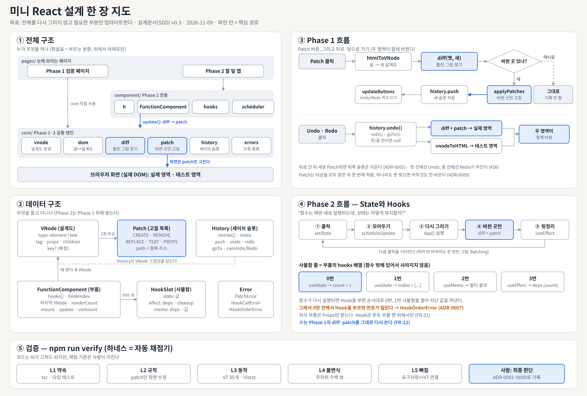
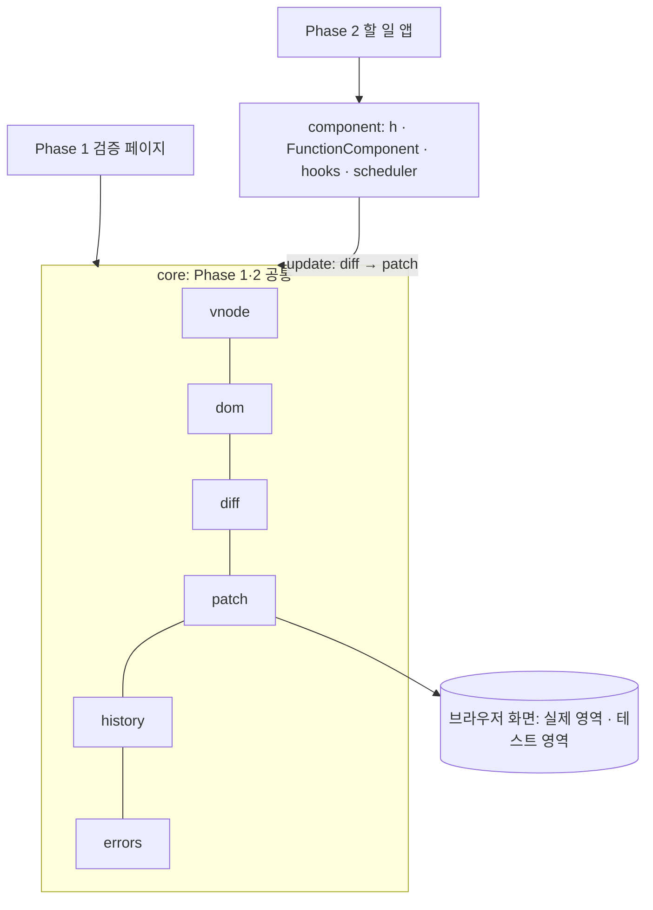
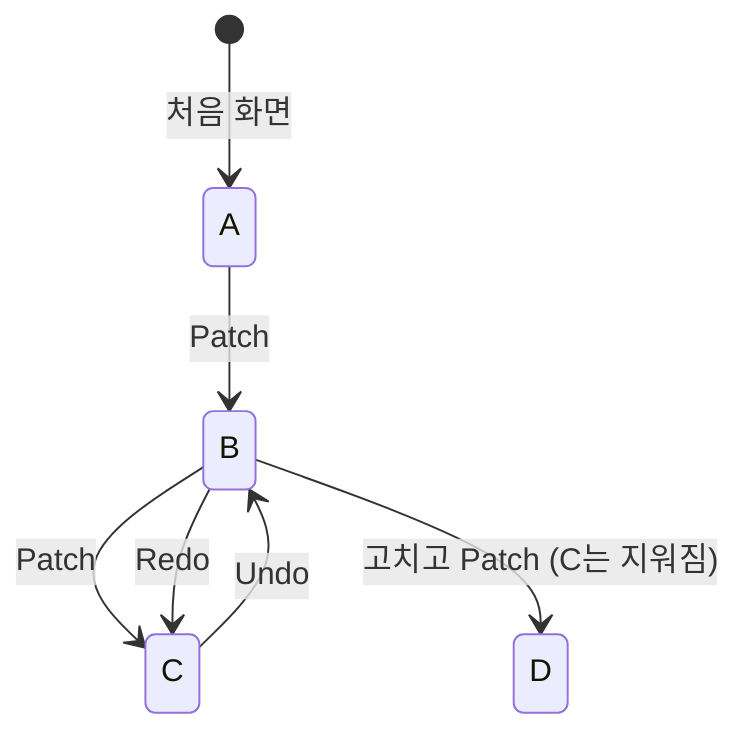

# 미니 React 설계 한 장 요약 (SDD One-Pager)

> 형식: IEEE 1016-2009 (Software Design Descriptions)의 목차를 한 장으로 줄인 것. 자세한 내용은 전체 설계문서 `SDD.md`, 결정 이유는 `docs/adr/`.

| 항목 | 내용 |
|---|---|
| 문서 | 미니 React 소프트웨어 설계 요약 v0.3 (Draft, 팀 검토 전) |
| 날짜 | 2026-11-09 |
| 기준 | SRS v1.0 (ISO/IEC/IEEE 29148), ADR-0001 TypeScript |
| 작성 | 프로젝트 팀 (초안: AI, 결정·검토: 팀) |



## 1. 목표 (LMS 과제 요구사항)

- 사용자의 입력·클릭에 따라 **부분 업데이트되는, 실제로 동작하는 웹 페이지**를 만든다.
- 핵심은 **전체를 다시 그리지 않고 필요한 부분만 업데이트**하는 것이다.
- **뒤로가기·앞으로가기**로 History에 저장된 특정 Virtual DOM으로 이동하고, 그때 **실제 영역과 테스트 영역이 함께** 바뀐다.
- **"함수는 매번 새로 실행되는데, 상태는 어떻게 유지할까?"**: 이 질문에 답하는 것이 Hooks의 핵심이다.

## 2. 쉬운 말 사전

| 어려운 말 | 쉬운 비유 |
|---|---|
| 실제 DOM / Virtual DOM | 실제로 쌓은 레고 집 / 그 집의 설계도 |
| Diff / Patch | 설계도 두 장으로 틀린 그림 찾기 / 틀린 블록만 갈아끼우기 |
| History | 게임 세이브 슬롯 (Undo = 이전 칸, Redo = 다음 칸) |
| State / Hook | 부품이 기억하는 점수판 / 그 값을 넣어 두는 사물함 |
| 하네스 / ADR | 자동 채점기 / "왜 이렇게 정했는지" 적은 일기장 |

## 3. 읽는 사람과 궁금한 점 (Stakeholders & Concerns)

| 읽는 사람 | 궁금한 점 | 볼 곳 |
|---|---|---|
| 구현 담당 | 내 함수의 입력·출력, 모듈 간 약속 | 4, 5장 |
| 테스트 담당 | VT를 어떻게 확인하나 | 7장 |
| 발표자·새 팀원 | 전체 흐름과 결정 이유 | 지도, 6장 |
| AI 코딩 도구 | 지켜야 할 규칙, 통과할 검사 | 4, 7장, `AGENTS.md` |

## 4. 구조와 의존 (Composition · Dependency)

화살표는 위에서 아래로만 흐른다. **실제 화면을 바꾸는 코드는 `core/patch.ts` 하나뿐**이다.



```text
src/core/        vnode.ts  dom.ts  diff.ts  patch.ts  history.ts  errors.ts
src/component/   h.ts  function-component.ts  hooks.ts  scheduler.ts
src/pages/       phase1/ (index.html, main.ts, init.ts)   phase2/ (index.html, main.ts, App.ts)
tests/           unit/  integration/  property/  helpers/
docs/            SRS.md  SDD.md  SDD_one_page.md  design_map.svg  adr/
```

## 5. 데이터와 함수 약속 (Information · Interface)

| 데이터 | 필드 | 역할 |
|---|---|---|
| `VNode` | `type`, `tag`, `props`, `children`, `key?` | 설계도 한 조각 |
| `Patch` | `CREATE`·`REMOVE`·`REPLACE`·`TEXT`·`PROPS` + `path` | 고칠 목록 한 줄 |
| `History<T>` | `entries[]`, `index` | 세이브 슬롯 |
| `FunctionComponent` | `hooks[]`, `hookIndex`, 마지막 `VNode` | 부품 하나와 그 사물함 줄 |
| `HookSlot` | `state` / `effect(deps, cleanup)` / `memo(deps, 값)` | 사물함 한 칸 |

| 주요 함수 | 입력 → 출력 | 하는 일 |
|---|---|---|
| `domToVNode(node)` / `htmlToVNode(html)` | 화면·글 → `VNode` | 설계도 그리기 |
| `diff(old, new)` | `VNode` 2개 → `Patch[]` | 틀린 그림 찾기 |
| `applyPatches(root, patches)` | 화면, `Patch[]` → 결과 | 바뀐 곳만 고치기 (못 찾으면 아무것도 안 바꿈) |
| `History.push / undo / redo / goTo` | 상태 → 상태 \| `null` | 슬롯 저장·이동 (끝이면 `null`) |
| `render(App, props, el)` | 부품 → `FunctionComponent` | 앱을 처음 올리기 |
| `useState / useEffect / useMemo` | 초기값·deps → 값 | 사물함에서 값 꺼내기 |
| `scheduleUpdate(c)` | 부품 → 없음 | 다시 그리기를 한 번만 예약 |

전체 함수 명세는 `SDD.md` 부록 A.

## 6. 동작 흐름과 결정 이유 (Interaction · State · Rationale)

**Phase 1: Patch**: 입력칸 글 → `htmlToVNode` → `diff(옛, 새)` → 바뀐 곳이 있으면 `applyPatches` → `history.push` → 버튼 상태 갱신. 바뀐 곳이 없으면 아무것도 하지 않는다.

**Phase 1: 뒤로·앞으로 가기**: `history.undo()`·`redo()`·`goTo(i)` → `diff + patch`로 실제 영역 갱신, `vnodeToHTML`로 테스트 영역 갱신 → 두 영역이 함께 바뀐다.



**Phase 2: 한 바퀴**: 클릭 → `setState` → `scheduleUpdate`(모아두기) → `App()` 다시 실행 → `diff + patch`(Phase 1 그대로) → `useEffect` 실행.

**Hooks의 답**: 값은 함수 밖, 부품마다 있는 **사물함 줄(`hooks` 배열)**에 있다. 함수가 다시 실행되면 Hook을 **부른 순서**대로 0번, 1번 사물함을 열어 지난 값을 꺼낸다. 그래서 if문 안에서 Hook을 부르면 번호가 밀리고, 이를 `HookOrderError`로 막는다.

| ADR | 결정 | 상태 |
|---|---|---|
| 0001 | TypeScript 사용 | accepted |
| 0002 | 뒤로 간 뒤 새로 Patch하면 뒤쪽 기록 삭제 | proposed |
| 0003 | 테스트 영역은 HTML 입력칸 + 미리보기 | proposed |
| 0004 | 같은 자리끼리 비교 + 5가지 Patch (key는 확장) | proposed |
| 0005 | Patch는 대상을 모두 찾은 뒤 한 번에 적용 | proposed |
| 0006 | microtask로 모아서 한 번만 그리기 (Batching) | proposed |
| 0007 | Hook 배열 + 런타임 규칙 검사 | proposed |
| 0008 | 테스트 하네스: Vitest + jsdom | proposed |
| 0009 | 설계 준수를 하네스로 자동 검증 | proposed |

## 7. 검증 (Verification)

`npm run verify` 하나로 다섯 칸을 채점한다. **코드는 AI가 고쳐도 되지만, 채점 기준은 사람이 지킨다.**

| 칸 | 무엇을 보나 | 도구 |
|---|---|---|
| L1 약속 | 함수 이름·입력·출력이 설계와 같나 | `tsc`, 타입 테스트 |
| L2 규칙 | 화면은 patch만 고치나, 층을 거꾸로 부르지 않나 | dependency-cruiser, ESLint |
| L3 동작 | VT-01~VT-35가 기대대로 되나 | Vitest + jsdom |
| L4 불변식 | 무작위 설계도 쌍에도 `patch(diff(a, b))` 결과가 b와 같나 | fast-check |
| L5 빠짐 | SRS의 모든 VT에 테스트가 있나 | `scripts/check-trace.ts` |

AI가 쓴 코드를 소화했는지는 **원리 설명 질문 카드**(`SDD.md` 부록 B)로 확인한다. 담당자가 답하지 못하면 PR을 병합하지 않는다.

## 8. 추적성 (요구사항 → 설계 → 검증)

| 요구사항 | 설계 | 검증 | 이슈 |
|---|---|---|---|
| FR-01~02 DOM 변환, 테스트 영역 | 3.2, 3.6 | VT-01, 02, 32~34 | #27 |
| FR-03~06 Patch, 부분 갱신 | 3.3, 3.4 | VT-03~06, 20, 27~29, 31 | |
| FR-07~08 History, Undo/Redo | 3.5, 3.6 | VT-07~09, 30 | #23, #25, #26 |
| FR-11~15 Component, Props, State | 4.1, 4.2 | VT-10, 11, 13 | |
| FR-16~21 useState, useEffect, useMemo, Hook 규칙 | 4.3, 4.6 | VT-12, 14~16 | |
| FR-22~23 Phase 1 재사용, Phase 2 페이지 | 4.2, 4.7 | VT-17~19 | |

설계 번호(3.x, 4.x)는 전체 설계문서 `SDD.md`의 절 번호다.
