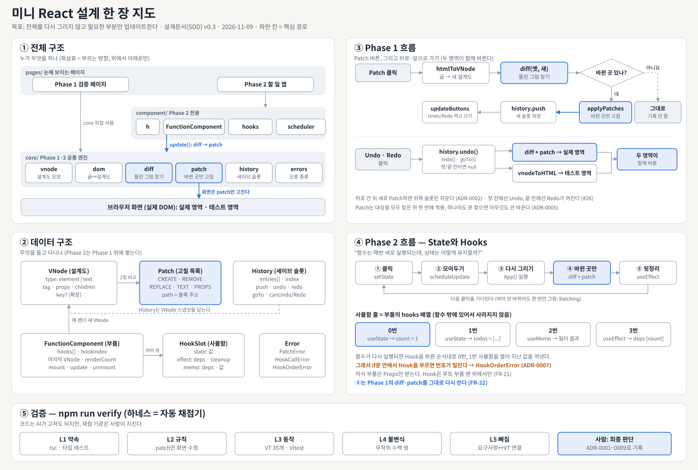
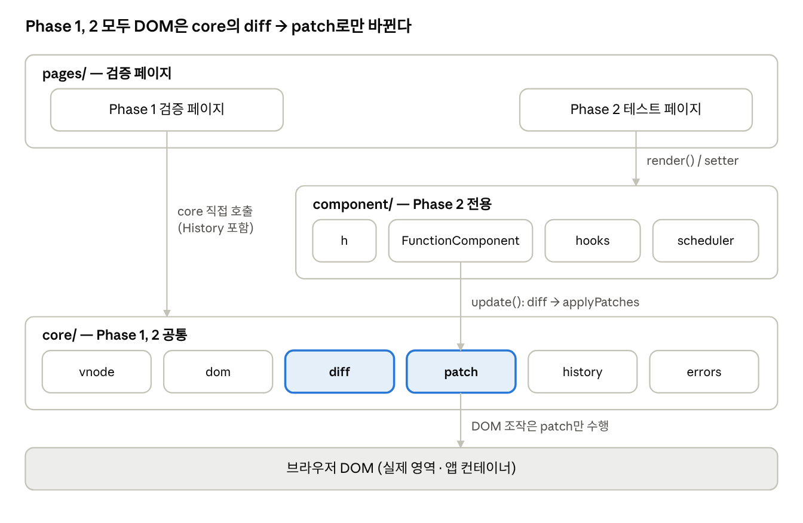
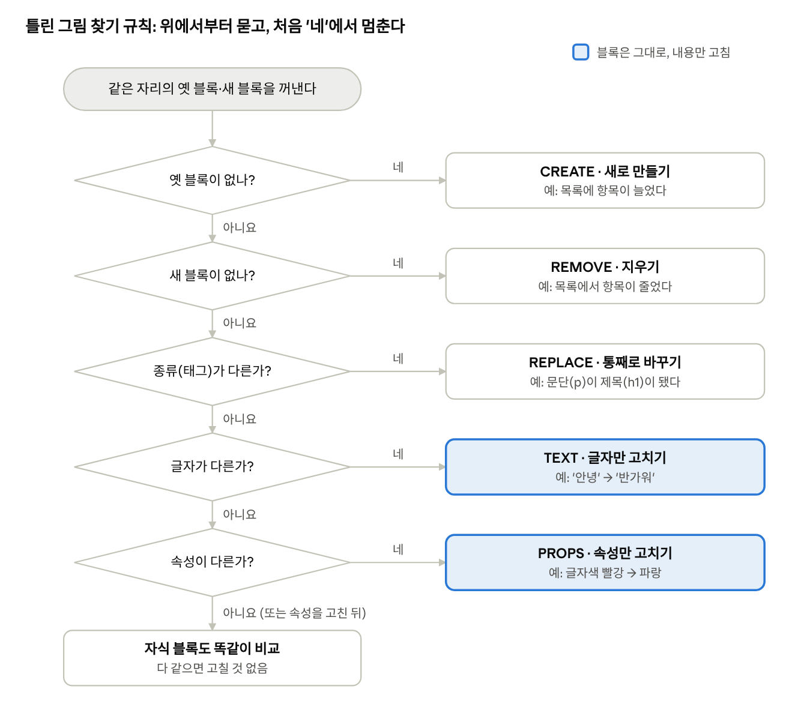
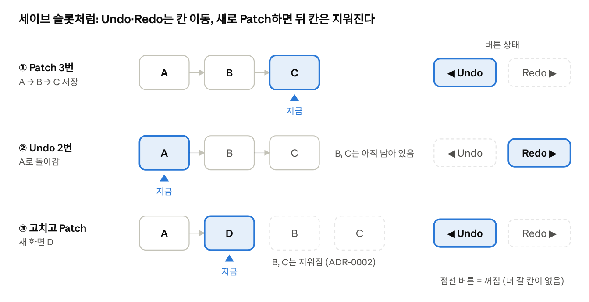
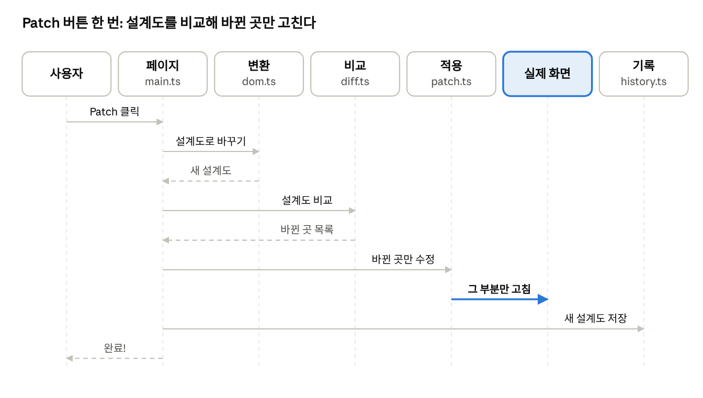

# 미니 React 소프트웨어 설계 문서 (SDD)

2026-11-10 · v0.5 · 프로젝트 팀 (초안: AI, 검토·결정: 팀)

> 이 문서는 공통 설계와 **Phase 1**을 다룬다. Phase 2(Component, State, Hooks)는 `SDD_fixed_phase2.md`, 결정 이유는 `adr/`, 한 장 요약은 `SDD_one_page.md`.



## 0. 한 장 요약 (쉬운 말)

**최종 목표 (LMS 과제 요구사항)**

- 사용자의 입력·클릭에 따라 **부분 업데이트되는, 실제로 동작하는 웹 페이지**를 만든다.
- 핵심은 **전체를 다시 그리지 않고 필요한 부분만 업데이트**하는 것이다 (3.3, 3.4).
- **뒤로가기·앞으로가기**로 State History에 저장된 특정 Virtual DOM으로 이동하고, 그때 **실제 영역과 테스트 영역이 함께** 바뀐다 (3.5, 3.6).
- **"함수는 매번 새로 실행되는데, 상태는 어떻게 유지할까?"** 에 답하는 것이 Hooks의 핵심이다 (`SDD_fixed_phase2.md`).

우리가 만드는 것은 "화면에서 바뀐 곳만 골라서 고치는 도구"다. 화면 전체를 다시 그리면 느리고 입력하던 글자도 사라지기 때문이다. React가 만들어진 이유도 이것이다.

레고 집으로 생각하면 쉽다. 설계도(종이)를 두 장 놓고 틀린 그림을 찾은 다음, 달라진 블록만 갈아끼운다.

| 어려운 말 | 쉬운 비유 | 우리 코드에서 |
| --- | --- | --- |
| 실제 DOM | 실제로 쌓아 올린 레고 집 | 브라우저 화면 |
| Virtual DOM (VNode) | 레고 집의 설계도 (종이 그림) | `VNode` 객체 |
| `dom` 참조 | 설계도의 블록 옆에 적어 둔 "실제 블록 위치" 메모 | `vnode.dom` |
| key | 블록마다 붙인 이름표 | `vnode.key` |
| Diff | 틀린 그림 찾기 | `diff(옛 설계도, 새 설계도)` → `{ changes, pairs }` |
| Patch | 틀린 곳의 블록만 갈아끼기 | `applyPatch` |
| State History | 게임 세이브 슬롯 | `History` (뒤로가기 = 이전 슬롯, 앞으로가기 = 다음 슬롯) |
| Component | 모양이 정해진 레고 부품 틀 | `App`, `TodoItem` 같은 함수 |
| State | 점수판처럼 기억해야 하는 값 | `useState` |
| 하네스 | 자동 채점기 | `npm run verify` |
| ADR | "왜 이렇게 정했는지" 적어 둔 일기장 | `docs/adr/` |

우리가 하는 일은 네 단계다.

1. **Phase 1**: 설계도를 비교해 바뀐 곳만 고치고, 세이브 슬롯으로 되돌릴 수 있게 한다 (3장).
2. **Phase 2**: 부품(Component)과 점수판(State)을 넣는다. 점수가 바뀌면 Phase 1 방식 그대로 바뀐 곳만 고친다 (`SDD_fixed_phase2.md`).
3. **검증**: 자동 채점기(하네스)가 매번 설계대로 만들었는지 확인한다 (6·8장).
4. **기록**: 중요한 결정은 이유와 함께 ADR에 남긴다. AI가 초안을 쓰고, 결정은 팀이 한다.

## 1. 문서 개요

본 문서는 SRS v1.3(`docs/SRS_fixed.md`)의 Phase 1 요구사항(FR-01~FR-09)과 공통 요구사항(NFR, IR, CON)을 TypeScript(ADR-0007) 모듈과 함수 단위로 구체화하고, 그 검증 방법을 정의한다. Phase 1 설계는 somage ADR-0001~0006을 기준으로 하고, 구 eungi ADR에서 살린 내용(ADR-0013, ADR-0014)과 팀 설계 검토(ADR-0008)를 더했다.

| 항목 | 내용 |
| --- | --- |
| 기준 문서 | SRS v1.3, ADR-0001~0014 (`docs/adr/README.md`) |
| 적용 범위 | 공통(아키텍처, 검증, 하네스, 역할), Phase 1 (VDOM, 변환, Diff, Patch, History, 검증 페이지) |
| 함께 읽는 문서 | `SDD_fixed_phase2.md` (Phase 2) |
| 문서 상태 | Draft: proposed ADR(0008~0014)이 accepted가 되면 1.0으로 확정 |

### 1.1 미결 사항(TBD)과 설계의 전제

SRS 6장의 TBD마다 이 설계가 따르는 결정이다.

| TBD | 설계가 따르는 결정 | 근거 | 영향 절 |
| --- | --- | --- | --- |
| TBD-01 | 선형 기록. 뒤로 간 뒤 Patch하면 뒤쪽 기록을 지운다 (j1) | ADR-0008 | 3.5 |
| TBD-02 | 코드 입력칸(원본) + Virtual DOM을 거쳐 그린 미리보기 | ADR-0006 | 3.2, 3.6 |
| TBD-03 | 변경 6종: `add`, `remove`, `replace`, `text`, `attrs`, `move` | ADR-0004, ADR-0005 | 3.3, 3.4 |
| TBD-04 | key 짝짓기. key 없는 자식끼리는 순서로 | ADR-0004 | 3.3 |
| TBD-05 | microtask Batching | ADR-0009 | `SDD_fixed_phase2.md` 2.4 |
| TBD-06 | VT 전체 통과 + core·component 구문 커버리지 90% | SRS TBD-06 | 6.1 |
| TBD-07 | 적용 전 전체 확인, 실패 시 DOM 변경 0건 | ADR-0013 (proposed) | 3.4, 5장 |
| TBD-08 | `<script>`, `on*`, `javascript:`를 변환에서 거름 | ADR-0014 (proposed) | 3.2, 5장 |
| TBD-09 | 재귀 유지. 테스트 깊이는 100겹(ADR-0005 D14·P11)으로 두고 팀이 최종 기준을 정한다 | ADR-0002 T9 | 3.2, 6장 |
| TBD-10 | 설계 범위 밖 (문서 ID 정렬). 이 문서는 SRS ID를 쓴다 | SRS 5.1.4 | 7장 |

### 1.2 문서 템플릿과 참고 표준

본 문서의 구성은 IEEE 1016-2009 (Software Design Descriptions)의 설계 관점(viewpoint) 구조를 과제 규모에 맞게 축약한 것이다. SRS가 ISO/IEC/IEEE 29148을 따르므로, 그 다음 단계 문서로 짝을 맞춘다.

| 표준 / 템플릿 | 대상 | 본 문서에서 쓴 부분 |
| --- | --- | --- |
| [IEEE 1016-2009](https://standards.ieee.org/ieee/1016/4502/) Software Design Descriptions | 설계 문서(SDD) | 전체 목차: 구성(2장), 인터페이스·정보(3장 타입/함수), 상호작용·상태(Patch 흐름, History), 설계 근거(1.1, ADR) |
| [ISO/IEC/IEEE 42010:2022](https://www.iso.org/standard/74393.html) Architecture description | 아키텍처 기술 | 2장 모듈 구성과 의존 방향 |
| [ISO/IEC/IEEE 29119-3:2021](https://www.iso.org/standard/79429.html) Test documentation | 테스트 문서 | 6장 테스트 설계 |
| [ISO/IEC/IEEE 29148:2018](https://www.iso.org/standard/72089.html) Requirements engineering | 요구사항(SRS) | 7장 추적성 (요구사항 ↔ 설계 ↔ VT) |
| [MADR](https://adr.github.io/madr/) Markdown Architectural Decision Records | ADR | `docs/adr/` 전체 |

IEEE·ISO 표준 원문은 유료이므로, 본 문서는 목차와 관점 구분만 참고했다.

### 1.3 GitHub Issue 대응

| Issue | 완료 조건 | 충족하는 절 | 산출물 |
| --- | --- | --- | --- |
| [#10 프로젝트 구조 및 함수 인터페이스 설계](https://github.com/team1-mini-lab/mini-react/issues/10) | 디렉터리 확정, 주요 함수 인터페이스, 모듈 책임 | 2.1, 2.2, 3.1~3.5, 부록 A | 본 문서, `check:arch` 규칙 (8장) |
| [#11 핵심 자료구조 설계](https://github.com/team1-mini-lab/mini-react/issues/11) | 필드·역할, 관계, Phase 1→2 확장 방향 | 3.1, 3.3, 3.5, `SDD_fixed_phase2.md` 2.1·2.8 | ADR-0001, ADR-0008 |
| [#12 테스트 환경 구성](https://github.com/team1-mini-lab/mini-react/issues/12) | 환경 실행, 실행 방법 문서화, 기능별 테스트 구조 | 6장, 8장 | ADR-0011, README "테스트 실행" 절 (8.5) |
| [#13 팀 역할 분담 및 설계 문서 작성](https://github.com/team1-mini-lab/mini-react/issues/13) | 담당 확정, 중복·누락 확인, 결정 기록 | 9장, 1.1 | 역할 분담 제안(9장), ADR-0001~0014 |

### 1.4 이 문서를 읽는 사람과 궁금한 점

| 읽는 사람 | 궁금한 점 | 먼저 볼 곳 |
| --- | --- | --- |
| 구현 담당 팀원 | 내가 만들 함수의 입력·출력, 다른 모듈과의 약속 | 1.6, 2장, 3장, 부록 A, 9장 |
| 테스트 담당 팀원 | VT를 어떻게 확인하나, 예외는 어떻게 처리하나 | 5·6·8장 |
| 발표자 / 새 팀원 | 전체가 어떻게 돌아가나, 왜 이렇게 정했나 | 0장, 부록 B, `docs/adr/README.md` 3·4절 |
| 코치 / 평가자 | 요구사항을 다 담았나, 원리를 설명할 수 있나 | 7장, 부록 B·D |
| AI 코딩 도구 | 지켜야 할 규칙과 통과해야 할 검사 | 1.6, 2장, 8장, `AGENTS.md` |

### 1.5 변경 이력

| 버전 | 날짜 | 바뀐 내용 |
| --- | --- | --- |
| 0.1 | 2026-11-09 | 초안: 1~7장 (AI 초안) |
| 0.2 | 2026-11-09 | 8장 하네스, 9장 역할 분담, ADR-0002~0009 추가 |
| 0.3 | 2026-11-09 | 0장 쉬운 요약, 그림 5개, 1.4 읽는 사람, 부록 A~E 추가 |
| 0.4 | 2026-11-09 | (PR #50 제안, 미병합) History `archive[]` 백업. ADR-0008 j1 채택으로 부록 C 확장 후보로 이동 |
| 0.5 | 2026-11-10 | **Phase 1을 somage ADR-0001~0006 기준으로 다시 씀** (노드 모양, 공백 규칙, `dom` 참조, key 짝짓기, 6종 변경, 적용 순서, 코드 입력칸 + 미리보기). ADR-0013(원자성)·ADR-0014(정제) 반영. 팀 설계 검토(ADR-0008) 반영: 저장된 기록의 `dom` 규칙, 이동 시 미리보기 갱신, 변경 없는 Patch, 수정 중 이동 금지. Phase 2를 `SDD_fixed_phase2.md`로 분리. ADR 번호를 통합 번호로 바꿈. 6장을 SRS VT·ADR 테스트 ID 참조 방식으로 줄임 |
| 1.0 | (팀 검토 후) | proposed ADR 승인 후 확정 예정 |

### 1.6 이름 대응표 (CF-07)

ADR은 설계 단계의 이름(snake_case, Python dict 표기)을 쓰고, 코드는 TypeScript 관례(camelCase)를 따른다(ADR-0007). 뜻은 같다.

| ADR의 이름 | 코드 이름 | 파일 | 근거 |
| --- | --- | --- | --- |
| dict, `node["type"]` | `VNode` 객체, `node.type` | `core/vnode.ts` | ADR-0001 표기 안내 |
| `dom_to_vdom(실제 노드, 기록 여부)` | `domToVNode(node, { recordDom })` | `core/dom.ts` | ADR-0002 |
| `vdom_to_dom(node)` | `vnodeToDom(v)` | `core/dom.ts` | ADR-0003 |
| a3 (Virtual DOM → 코드) | `vnodeToHtml(v)` | `core/html.ts` | ADR-0006 3절 |
| g1 (코드 → Virtual DOM) | `htmlToVNode(code)` | `core/html.ts` | ADR-0006 2절 |
| Diff, 변경 목록, 짝 목록 | `diff(oldV, newV)` → `{ changes, pairs }` | `core/diff.ts` | ADR-0004, ADR-0005 |
| Patch | `applyPatch(result)` | `core/patch.ts` | ADR-0005, ADR-0013 |
| F1 (새 노드 `dom` 기록) | `recordDom(v, node)` | `core/patch.ts` | ADR-0005 2-1절 |
| FR-01 비교 (다섯 키) | `equalScreen(a, b)` | `core/vnode.ts` | ADR-0004 6절 |
| 왕복 비교 (다섯 키 + `key`) | `equalTree(a, b)` | `core/vnode.ts` | ADR-0003 Confirmation |

## 2. 아키텍처 개요

의존성은 `pages → component → core → DOM` 한 방향으로만 흐른다. core는 component를 모른다. **실제 영역**을 바꾸는 코드는 `core/patch.ts` 한 곳뿐이다 (NFR-04, FR-22). 미리보기는 실제 영역이 아니므로 통째로 다시 그려도 되고(ADR-0006 4절), 그 코드는 `pages/phase1/preview.ts` 한 곳에 둔다.



> 그림 갱신 필요: `arch.png`의 `dom` 모듈 옆에 `html` 모듈을 추가해야 한다.

Phase 1 페이지는 core를 직접 호출하고, Phase 2는 FunctionComponent가 같은 `diff`·`applyPatch`를 호출한다. 이 두 함수가 FR-22·C-08이 요구하는 공통 경로다.

### 2.1 디렉터리 구조

```text
mini-react/
  src/
    core/
      vnode.ts               VNode 타입, h(), equalScreen, equalTree
      dom.ts                 domToVNode, vnodeToDom
      html.ts                htmlToVNode, vnodeToHtml
      diff.ts                diff, Change·Pair·DiffResult 타입
      patch.ts               applyPatch, recordDom, mountTree, unmountTree
      history.ts             History<T>
      errors.ts              PatchError (Phase 2 오류는 SDD_fixed_phase2 참조)
    component/               SDD_fixed_phase2.md
    pages/
      phase1/ index.html, main.ts, init.ts, preview.ts
      phase2/ SDD_fixed_phase2.md
  tests/                     6장 참조
  docs/
    SRS_fixed.md
    SDD.md                   본 문서 (공통 + Phase 1)
    SDD_fixed_phase2.md      Phase 2
    adr/  README.md, adr_0001 ~ adr_0014 (MADR)
```

### 2.2 모듈별 책임

| 모듈 | 책임 | DOM 접근 | 의존 |
| --- | --- | --- | --- |
| vnode | 데이터 타입, VNode 생성, 두 가지 비교 | 없음 | — |
| dom | 실제 DOM ↔ VNode 변환, 정제 | 읽기, 화면 밖 새 노드 생성 | vnode |
| html | 코드 ↔ VNode 변환 | `<template>`(화면 밖)에서 읽기 | vnode, dom |
| diff | 두 VNode 비교 → `{ changes, pairs }` | 없음 (순수 함수, `dom`도 읽지 않음) | vnode |
| patch | 변경 확인 후 실제 영역에 적용, `dom` 이어받기 | 실제 영역 쓰기 (유일) | vnode, dom, diff, errors |
| history | 상태 기록, 이동 커서 | 없음 | — |
| pages/phase1 | 흐름 연결, 버튼·안내 상태, 미리보기 그리기 | 미리보기 틀만 쓰기 (`preview.ts`) | core |

## 3. Phase 1 설계

Phase 1은 "코드 → VNode → Diff → `{ changes, pairs }` → Patch → 실제 영역" 한 방향 흐름이며, 뒤로가기·앞으로가기도 같은 Diff·Patch 경로를 쓴다. 실제 영역을 `innerHTML`로 통째 교체하는 코드는 **어디에도 없다** (첫 로드에도 다시 그리지 않고 `dom`만 기록한다).

### 3.1 Virtual DOM 데이터 구조 (`core/vnode.ts`, ADR-0001)

```typescript
export type Attrs = Record<string, string>;

export interface VElement {
  type: 'element';
  tag: string;                          // 항상 소문자 (localName)
  attrs: Attrs;                         // 없으면 {}. key는 넣지 않는다
  children: VNode[];                    // 없으면 []
  key?: string;                         // 짝짓기용 이름표. 없으면 키 자체가 없다
  dom?: Element;                        // 실제 영역에 그려진 트리에만 있다
  on?: Record<string, EventListener>;   // Phase 2 전용 (SDD_fixed_phase2 2.1)
}

export interface VText {
  type: 'text';
  text: string;                         // 공백 규칙 적용 후 (ADR-0002)
  dom?: Text;
}

export type VNode = VElement | VText;

export function h(tag: string, attrs?: (Attrs & { key?: string }) | null, ...children: (VNode | string)[]): VElement;
export function equalScreen(a: VNode, b: VNode): boolean;  // 다섯 키 (FR-01 비교 기준)
export function equalTree(a: VNode, b: VNode): boolean;    // 다섯 키 + key (왕복 비교)
```

키는 성격에 따라 무리로 나뉘고, 비교마다 보는 무리가 다르다 (ADR-0001, ADR-0004 6절).

| 무리 | 키 | 하는 일 | `equalScreen` | `equalTree` | `diff` |
| --- | --- | --- | --- | --- | --- |
| 화면 데이터 | `type`, `tag`, `attrs`, `text`, `children` | 화면 모습 | ✅ | ✅ | ✅ |
| 짝짓기 정보 | `key` | 자식 목록에서 누구인지 | ❌ | ✅ | 짝지을 때만 |
| 참조 | `dom` | 실제 노드 위치 | ❌ | ❌ | ❌ |
| 동작 (Phase 2) | `on` | 이벤트 핸들러 | ❌ | ❌ | ❌ (Patch가 동기화) |

규칙

- 노드 종류는 `node.type`으로만 구별한다. `'text' in node` 같은 키 존재 검사는 쓰지 않는다.
- 태그 노드에는 `attrs`와 `children`이 항상 있다 (VT-25, VT-26).
- **화면 데이터와 `key`는 만든 뒤 바꾸지 않는다. `dom`은 Patch만 쓰며, 지금 실제 영역에 그려진 트리에서만 믿는다** (ADR-0004 `dom` 규칙 7, ADR-0008 4절). History에 저장된 트리도 이 규칙을 따른다.
- `equalScreen`과 `equalTree`는 다른 함수로 만든다. 하나는 `key`를 빼고, 하나는 넣는다 (ADR-0004 Confirmation).
- `h()`는 테스트와 Phase 2를 위한 생성 도우미다. `attrs.key`가 있으면 `key`로 옮기고 `attrs`에서 뺀다.

### 3.2 변환 (`core/dom.ts`, `core/html.ts`)

| 함수 | 입력 → 출력 | 역할 | 근거 | FR / IR |
| --- | --- | --- | --- | --- |
| `domToVNode(node, opts?)` | `Element \| Text`, `{ recordDom?: boolean }` → `VNode` | 실제 DOM을 VNode로. `recordDom`이면 모든 객체에 `dom` 기록 | ADR-0002, ADR-0014 | FR-01, IR-04 |
| `vnodeToDom(v)` | `VNode` → `Node` | 화면 밖에서 트리를 재귀로 완성해 반환. 붙이는 것은 호출한 쪽이 1번 | ADR-0003 | FR-01, FR-06, IR-09 |
| `htmlToVNode(code)` | `string` → `VNode \| null` | `<template>`에 넣어 읽은 뒤 첫 요소를 `domToVNode`(기본 모드)로. 요소가 없으면 `null` | ADR-0006 g1 | FR-02, FR-03, IR-10 |
| `vnodeToHtml(v)` | `VNode` → `string` | VNode를 코드로. 원래 공백 자리만 줄바꿈·들여쓰기 | ADR-0006 a3 | FR-08, IR-10 |

**`domToVNode` 규칙** (ADR-0002, ADR-0014)

1. 부모는 `childNodes`를 순서대로 돌며 `nodeType`이 1(태그) 또는 3(글자)인 것만 변환한다. 주석과 `<script>` 요소는 건너뛴다. 그래서 결과는 언제나 객체 하나이고 `children`에 `null`이 없다.
2. 태그 이름은 `localName`으로 읽는다 (`tagName`은 대문자).
3. 속성 중 `key`는 `key`로 옮기고 `attrs`에서 뺀다. 이름이 `on`으로 시작하는 속성과, 값이 `javascript:`로 시작하는 `href`·`src`·`action`·`formaction`·`xlink:href`는 넣지 않는다.
4. 글자는 `<pre>`와 그 자손 안이 아니면 `/[ \t\n\r\f]+/g`를 공백 한 칸으로 바꾼다. `\s`는 `&nbsp;`까지 줄이므로 쓰지 않는다. 공백만 있는 글자 노드도 버리지 않고 `" "`으로 남긴다.
5. `recordDom: true`는 **실제 영역을 처음 변환할 때만** 쓴다. 테스트 영역 쪽 노드가 `dom`에 들어가면 Patch가 엉뚱한 영역을 고친다.
6. Node가 아닌 값이 들어오면 `TypeError`.

**`vnodeToDom` 규칙** (ADR-0003)

- `attrs`마다 `setAttribute`, `key`가 있으면 `setAttribute('key', key)`로 다시 붙인다.
- `dom`을 읽지도 기록하지도 않는다. 미리보기를 그릴 때도 쓰이기 때문이다. 새로 만든 노드의 `dom` 기록은 Patch의 `recordDom`이 한다.
- 화면(라이브 DOM)에 붙이는 코드는 이 함수 안에 없다.

**`vnodeToHtml` 규칙** (ADR-0006 a3)

- 공백 노드(`" "`)가 원래 있던 자리만 줄바꿈 + 들여쓰기(2칸)로 바꾼다. 없던 자리는 붙여 쓴다. 그래서 고친 것 없이 다시 읽으면 같은 트리가 되고, 고친 것 없이 Patch하면 변경이 0개다.
- `<pre>` 안은 바꾸지 않는다. 글자의 `<`·`&`는 `&lt;`·`&amp;`, 속성 값의 `"`는 `&quot;`로 적는다. `key`는 `key` 속성으로 적는다. `<br>`·`` 같은 빈 요소는 닫는 태그를 쓰지 않는다.

### 3.3 Diff (`core/diff.ts`, ADR-0004, ADR-0005)

```typescript
export type Change =
  | { kind: 'add';     parent: VElement; node: VNode; before: VNode | null }
  | { kind: 'remove';  target: VNode }
  | { kind: 'replace'; target: VNode; node: VNode }
  | { kind: 'text';    target: VText; text: string }
  | { kind: 'attrs';   target: VElement; set: Attrs; remove: string[] }
  | { kind: 'move';    target: VNode; parent: VElement; before: VNode | null };

export type Pair = readonly [oldNode: VNode, newNode: VNode];
export interface DiffResult { changes: Change[]; pairs: Pair[] }

export function diff(oldV: VNode, newV: VNode): DiffResult;
```

- `target`·`parent`·`before`는 **이전 트리의 객체**, `node`는 **새 트리의 객체**를 가리킨다. 실제 노드는 가리키지 않는다.
- `diff`는 `dom`을 읽지도 비교하지도 않는다. 그래서 `dom`이 없는 객체 두 개만으로 테스트할 수 있다 (ADR-0005 D12).
- `changes`에는 바뀐 것만, `pairs`에는 실제 노드를 계속 쓰는 쌍(글자 수정, 속성 수정, 변경 없음, 이동한 노드)만 담는다. 교체는 `pairs`에 넣지 않는다.
- 위치는 번호가 아니라 **기준 객체**(`before`: 그 순간 그 자리에 있는 이전 객체, 없으면 `null` = 끝)로 담는다. 주석 때문에 번호가 어긋나는 문제를 피한다.

**노드 하나 비교** (위에서부터 처음 맞는 칸으로 정한다)

| 순서 | 조건 | 변경 | 자식 비교 | 관련 |
| --- | --- | --- | --- | --- |
| 1 | 이전엔 없고 새로 있음 | `add` | ✗ | VT-04 |
| 2 | 이전엔 있고 새로 없음 | `remove` | ✗ | VT-04 |
| 3 | `type`이 다름 | `replace` | ✗ | FR-06, VT-05 |
| 4 | 둘 다 태그, `tag`가 다름 | `replace` | ✗ | FR-06, VT-05 |
| 5 | 둘 다 글자, `text`가 다름 | `text` | — | FR-05, VT-04 |
| 6 | 둘 다 태그, `tag` 같음, `attrs` 다름 | `attrs` (`set`·`remove`) | ○ | FR-05, VT-27 |
| 7 | 그 밖 | 없음 | 태그면 ○ | VT-28 |
| + | 짝은 맞는데 자리가 다름 | `move` (1~7 결과와 함께) | — | FR-09, VT-36 |

**자식 목록 짝짓기** (FR-09)

| 규칙 | 내용 |
| --- | --- |
| key 있는 자식 | 이전 자식들로 key 장부(key → 이전 객체)를 만들고 같은 key끼리 짝짓는다 |
| key 없는 자식 | key 없는 자식끼리 그들 사이의 순서대로 짝짓는다 |
| 짝 없는 새 자식 / 이전 자식 | `add` / `remove` |
| 중복 key | 같은 부모에 같은 key가 둘 이상이면 `console.warn` 후 그 부모의 자식 전체를 자리 비교로 처리한다 |
| key가 바뀐 항목 | 다른 항목으로 보고 `remove` + `add` (의도된 동작) |
| 순서 맞추기 | 새 자식을 앞에서부터 보며, 이전 트리의 순서를 흉내 내어 이미 그 자리면 그대로, 아니면 `move`. 추가도 같은 방식으로 제자리에 넣는다 |

**변경 목록의 순서** = Patch의 적용 순서 (ADR-0005 5절). 부모마다:

1. 짝 없는 이전 자식의 `remove`
2. 새 자식을 앞에서부터 한 자리씩: 자리 맞추기(`move`/`add`) → 그 노드 자신의 변경(`replace`/`text`/`attrs`) → 그 노드의 자식들(재귀)

이 순서여야 `[A(p), B]` → `[B, A(h1)]`처럼 순서 변경과 교체가 함께 일어날 때 기준 노드가 교체로 떨어져 나가기 전에 쓰인다 (ADR-0005 P6).

**알려진 한계** (해결하지 않음, ADR-0004 7절): 이동 횟수를 최소화하지 않는다(`[A,B,C,D]` → `[B,C,D,A]`는 `move` 3번). key 없는 노드(글자·공백)가 끼어들면 그 뒤 key 없는 자식이 밀린다.



> 그림 갱신 필요: `diff.png`는 v0.3의 5종(CREATE 등) 기준이다. 위 표의 6종으로 다시 그려야 한다.

### 3.4 Patch (`core/patch.ts`, ADR-0005, ADR-0013)

```typescript
export class PatchError extends Error {
  constructor(public change: Change, message: string);
}

export function applyPatch(result: DiffResult): { applied: number };
export function recordDom(v: VNode, node: Node): void;          // F1: 새 트리와 실제 노드를 나란히 내려가며 dom 기록
export function mountTree(container: Element, v: VNode): void;  // Phase 2 첫 렌더 전용 (SDD_fixed_phase2 2.2)
export function unmountTree(v: VNode): void;                    // Phase 2 unmount 전용
```

`applyPatch`는 네 단계로 진행한다.

| 단계 | 하는 일 | 근거 |
| --- | --- | --- |
| 0. 확인 | 모든 변경의 `target`·`parent`·`before`에 `dom`이 있고 문서에 붙어 있는지, `before.dom`이 `parent.dom`의 자식인지 확인한다. 하나라도 어긋나면 `PatchError`를 던지고 **DOM은 0건 바뀐다** | ADR-0013 |
| 1. 적용 | `changes`를 순서대로 적용한다 (아래 표) | ADR-0005 5절 |
| 2. `dom` 복사 | `pairs`의 모든 쌍에 `새.dom = 이전.dom` | ADR-0005 2절 |
| 3. 새 노드 기록 | `add`·`replace`로 만든 노드마다 `recordDom(새 객체, 만든 노드)` | ADR-0005 2-1절 |

| 변경 | DOM 조작 | 노드 객체 |
| --- | --- | --- |
| `add` | `parent.dom.insertBefore(vnodeToDom(node), before?.dom ?? null)` | 새로 만듦 |
| `remove` | `target.dom.remove()` | 떼어 냄 |
| `replace` | `target.dom.replaceWith(vnodeToDom(node))` | 교체 (FR-06) |
| `text` | `target.dom.nodeValue = text` | 유지 (FR-05) |
| `attrs` | `set`마다 `setAttribute`, `remove`마다 `removeAttribute` | 유지 (FR-05) |
| `move` | `parent.dom.insertBefore(target.dom, before?.dom ?? null)` | 유지, 입력값·커서가 따라감 (FR-04, FR-09) |

**`value`·`checked`·`selected` 규칙 (CF-10)**: 사용자가 입력칸에 타이핑한 뒤에는 `value` 속성을 바꿔도 화면 값이 바뀌지 않는다. 그래서 이 세 속성은 `setAttribute`와 함께 같은 이름의 프로퍼티도 쓰되, **현재 프로퍼티 값과 다를 때만** 쓴다(커서 유지). 이 속성들이 `attrs` 변경으로 나왔을 때만 쓰므로, 바뀌지 않은 입력칸의 사용자 입력은 그대로다 (FR-04). 구 eungi 설계의 `setProp`에서 살린 규칙이다.

- 루트도 교체될 수 있다. 실제 영역은 틀(`#real-area`)의 첫 자식이 루트이고, 틀은 고정이다 (ADR-0006 6절, CF-09).
- Phase 2의 `on` 동기화는 2단계와 3단계에 붙는다 (`SDD_fixed_phase2.md` 2.1).

### 3.5 History (`core/history.ts`, ADR-0008)

```typescript
export class History<T> {
  constructor(initial: T, limit = 100);
  get current(): T;
  get index(): number;
  get size(): number;
  push(state: T): void;            // index 뒤 기록을 지우고 추가 (j1)
  undo(): T | null;                // 처음이면 null, index 변화 없음
  redo(): T | null;                // 끝이면 null
  goTo(index: number): T | null;   // 선택: 특정 기록으로 이동, 범위 밖이면 null (부록 C 3번)
  canUndo(): boolean;              // index > 0
  canRedo(): boolean;              // index < size - 1
}
```

- **첫 로드 상태가 0번 기록이다.** 변경 있는 Patch를 n번 하면 `size === n + 1` (FR-07).
- **변경이 없는 Patch(`changes` 0개)는 기록하지 않고** "변경 사항 없음"을 표시한다 (k1, FR-07, VT-29, VT-47).
- 한도(100)를 넘으면 가장 오래된 기록부터 버린다.
- History에는 Patch가 `dom`을 채운 **바로 그 트리 객체**를 넣는다. 복사본을 넣으면 다음 Diff의 "이전" 쪽에 `dom`이 없다.
- 저장된 트리의 화면 데이터와 `key`는 바꾸지 않는다. 그 트리로 이동할 때 Patch가 `dom`만 써 넣는다 (3.1 규칙).
- 잘린 기록 보관(`archive[]`)은 하지 않는다. 확장은 History 모듈 안에서 끝난다 (부록 C 7번).



파란 칸이 지금 화면이다. 첫 칸에서는 뒤로가기가, 마지막 칸에서는 앞으로가기가 꺼진다 (#26). 코드 입력칸에 Patch하지 않은 수정이 있어도 둘 다 꺼진다 (3.6). 뒤로 간 다음 새로 Patch하면 그 뒤 칸은 지워진다 (ADR-0008).

### 3.6 Phase 1 검증 페이지 (`pages/phase1`, ADR-0006, ADR-0008)

**화면 구성**

```html
<section id="real-area"><div id="app">…샘플…</div></section>   <!-- 실제 영역 틀 (고정) -->
<textarea id="code"></textarea>                                 <!-- 코드 입력칸 (원본) -->
<section id="preview"></section>                                <!-- 미리보기 틀 (보기 전용) -->
<button id="patch">Patch</button> <button id="undo">뒤로가기</button> <button id="redo">앞으로가기</button>
<span id="history-pos">2 / 4</span> <p id="status"></p> <pre id="change-log"></pre>
```

- 페이지 코드는 샘플 안의 `id`로 요소를 찾지 않는다. 루트는 항상 틀의 첫 자식 요소다 (CON-07). 실제 영역과 미리보기에 같은 `id`가 두 개씩 생기기 때문이다.
- 샘플 HTML에는 `<textarea>`, `<style>`, SVG, `on*` 속성, `<label for>`, `<a href="#…">`를 쓰지 않는다 (ADR-0002, ADR-0006 7절, ADR-0014의 전제).

**페이지가 들고 있는 상태**: `current`(지금 실제 영역에 그려진 트리, `dom` 있음), `history`, `dirty`(Patch하지 않은 수정이 있는가), `pending`(입력 후 0.3초 판단 대기 중인가).

**흐름**

| 언제 | 순서 | FR / IR / VT |
| --- | --- | --- |
| 첫 로드 (`init`) | `current = domToVNode(#real-area 첫 자식, { recordDom: true })` → `history = new History(current)` → `#code ← vnodeToHtml(current)` → 미리보기 그리기 → 버튼 갱신. 실제 영역은 다시 그리지 않는다 | FR-01, VT-33, VT-37 |
| 코드 입력 | 즉시 `pending = true`, 두 이동 버튼 끔 (n2) → 0.3초 멈추면: `draft = htmlToVNode(code)` → 미리보기 그리기 → `dirty = diff(current, draft).changes.length > 0` → `pending = false` → 버튼 갱신, `dirty`면 안내 문구 | FR-02, FR-08, IR-01, VT-34, VT-40, VT-48 |
| Patch | 대기 중인 0.3초 타이머 취소 → `next = htmlToVNode(code)` (없으면 "루트 요소가 필요합니다", 중단) → 미리보기 즉시 그리기 → `result = diff(current, next)` → `changes`가 0개면 "변경 사항 없음", 기록 안 함 → 아니면 `applyPatch(result)` → `history.push(next)` → `current = next` → `dirty = false` → 버튼 갱신, 변경 목록 로그 | FR-03, FR-07, IR-02, VT-06, VT-39, VT-47 |
| 뒤로가기 / 앞으로가기 | (`dirty`나 `pending`이면 버튼이 꺼져 있다) `target = history.undo()`(또는 `redo`) → `applyPatch(diff(current, target))` (변경 0개여도 부른다. `dom` 이어받기) → `current = target` → `#code ← vnodeToHtml(target)` → 미리보기 그리기 → 버튼 갱신 | FR-08, IR-03, VT-08, VT-09, VT-49 |
| 버튼 갱신 | 뒤로가기 꺼짐 = `!history.canUndo() \|\| dirty \|\| pending`, 앞으로가기 꺼짐 = `!history.canRedo() \|\| dirty \|\| pending`. 기록 표시는 `index + 1 / size` | FR-08, VT-30, VT-48 |
| 미리보기 그리기 (`preview.ts`) | `#preview.replaceChildren(vnodeToDom(v))`. 실제 영역이 아니므로 통째로 그려도 FR-04와 무관 | FR-01, IR-09 |



> 그림 갱신 필요: `seq.png`에 "미리보기 즉시 그리기", "변경 0개면 기록 안 함", 이동 흐름의 "미리보기 그리기"를 추가해야 한다.

## 4. Phase 2 설계

`SDD_fixed_phase2.md`로 분리했다. Phase 2는 이 문서 3.1~3.4의 VNode, `diff`, `applyPatch`를 그대로 쓴다 (FR-22, C-08).

## 5. 예외 처리 및 경계 조건 (Phase 1)

원칙은 "프로그래머 오류는 던지고, 사용자 입력은 관대하게"다. 이 표가 SRS VT-21, VT-25~VT-31의 "정의된 처리 결과"다. Phase 2 항목은 `SDD_fixed_phase2.md` 3장에 있다.

| 상황 | 모듈 | 정의된 처리 결과 | VT |
| --- | --- | --- | --- |
| 자식이 없는 요소 변환 | dom | `children: []` | VT-25 |
| 속성이 없는 요소 변환 | dom | `attrs: {}` | VT-26 |
| `domToVNode(null)` 또는 Node가 아닌 값 | dom | `TypeError` | VT-21 |
| 주석, `<script>` | dom | 부모가 건너뜀 (Virtual DOM에 없음) | VT-21, VT-02 |
| `on*` 속성, `javascript:` 주소 | dom | `attrs`에 넣지 않음 | VT-21 |
| 닫히지 않은 태그 등 잘못된 HTML | html | 브라우저가 고쳐 읽은 결과를 그대로 사용, 오류 없음 | VT-42 |
| 코드에 요소가 하나도 없음 | page | `htmlToVNode`가 `null`, "루트 요소가 필요합니다" 표시, Patch 중단 | VT-21 |
| 기존 속성 삭제 | diff | `attrs.remove`에 이름 기록 | VT-27 |
| 동일한 VNode 비교 | diff | `changes: []`, `pairs`에 모든 노드 | VT-28 |
| 같은 부모의 중복 key | diff | `console.warn`, 그 부모는 자리 비교 | VT-36 |
| 같은 내용(들여쓰기만 다름 포함)으로 Patch | page | DOM 변경 0건, 기록 추가 없음, "변경 사항 없음" 표시 | VT-29, VT-47 |
| 기록이 하나뿐일 때 / 처음·끝에서 이동 | history | `null` 반환, index와 화면 변화 없음, 버튼 꺼짐 | VT-30 |
| Patch하지 않은 수정이 있을 때 이동 | page | 버튼 꺼짐, 안내 문구 | VT-48 |
| 대상 `dom`이 없거나 화면에서 떨어진 변경 | patch | `PatchError`, DOM 변경 0건 (적용 전 확인) | VT-31 |
| 루트 `tag` 변경 | patch | 루트 교체 성공, 틀은 그대로 | VT-41 |

오류 클래스는 `core/errors.ts`에 모아 둔다. 테스트는 메시지가 아니라 클래스로 판별한다 (`toThrow(PatchError)`).

## 6. 검증 설계

**무엇을 확인하고 무엇이 합격인지는 SRS 4장(VT)과 ADR의 Confirmation 표에 있다.** 이 장은 그 테스트를 **어디서, 어떤 도구로** 돌리는지만 정한다. 합격 기준을 여기에 다시 적지 않는다. 테스트 이름에는 VT ID와 ADR 테스트 ID를 붙인다 (예: `it('[VT-36][D6] 맨 앞 추가는 add 1개', …)`).

### 6.1 테스트 환경 (CON-05, VT-35, ADR-0011)

| 항목 | 선택 | 비고 |
| --- | --- | --- |
| 빌드 / 개발 서버 | Vite + TypeScript (`strict: true`) | ADR-0007 |
| 테스트 러너 | Vitest | `npm test` |
| DOM 환경 | jsdom (`environment: 'jsdom'`) | `<template>`, `MutationObserver` 지원 |
| 시간 | `vi.useFakeTimers()` | 0.3초 debounce (VT-40, VT-48) |
| 커버리지 | `@vitest/coverage-v8`, core·component 구문 90% | SRS TBD-06 |
| 브라우저 검증 | Playwright (선택) | 스크롤·커서 유지는 jsdom이 레이아웃을 계산하지 않아 여기서만 확인 |

### 6.2 테스트 파일과 담당 검증 항목

| 파일 | SRS VT | ADR 테스트 |
| --- | --- | --- |
| `tests/unit/vnode.test.ts` | VT-22(일부: 두 비교 함수 분리) | ADR-0001 Confirmation |
| `tests/unit/dom.test.ts` | VT-01, VT-02, VT-21, VT-25, VT-26, VT-37, VT-38 | ADR-0002 T1~T15, ADR-0003 Confirmation, ADR-0014 Confirmation |
| `tests/unit/html.test.ts` | VT-39 | ADR-0006 TA1~TA6 |
| `tests/unit/diff.test.ts` | VT-03, VT-04, VT-05, VT-27, VT-28, VT-36 | ADR-0005 D1~D15 |
| `tests/unit/patch.test.ts` | VT-06, VT-20, VT-29, VT-31, VT-43, VT-44, VT-45, VT-46 | ADR-0005 P1~P12, ADR-0013 Confirmation |
| `tests/unit/history.test.ts` | VT-07, VT-30 | ADR-0008 Confirmation (j1, 가역성) |
| `tests/integration/phase1.test.ts` | VT-08, VT-09, VT-40, VT-41, VT-42, VT-47, VT-48, VT-49 | ADR-0006 TA7~TA12, ADR-0008 Confirmation (k1, m3, n2) |
| `tests/property/*.prop.test.ts` | VT-03, VT-06, VT-28 (보강) | 8.3 불변식 |
| 6.5 기능 체크리스트 | VT-24, VT-32, VT-33, VT-34, FR-04 스크롤·커서 | — |
| 코드 검토 | VT-22, VT-23 | ADR-0004·0005 "코드 검토" 항목 |
| CI 환경 확인 | VT-35 | `npm test`가 jsdom에서 실행되고 CI 로그에 남는다 (ADR-0011) |

### 6.3 측정 도구 (`tests/helpers/`)

| 도우미 | 하는 일 | 쓰는 곳 |
| --- | --- | --- |
| `sameNode(before, after)` | Patch 전 `vnode.dom`을 잡아 두고 Patch 후 `toBe`로 같은 객체인지 확인 | FR-04, FR-05, VT-43 |
| `countMutations(root, fn)` | `MutationObserver`(`childList`, `attributes`, `characterData`, `subtree`)로 `fn` 동안의 기록 수를 센다. 전달을 기다린 뒤 센다 | NFR-01, VT-20, VT-29, VT-31, VT-38 |
| `stripDom(v)` | `dom` 키를 지운 복사본. Diff 테스트를 `dom` 없이 돌릴 때 | VT-03 (D12) |
| `equalScreen` / `equalTree` | 3.1의 두 비교 함수 그대로. FR-01 확인은 `equalScreen`, 왕복은 `equalTree` | VT-37, VT-38 |
| `fixture(html)` | 틀 + 샘플을 jsdom 문서에 붙이고 `init()`까지 실행 | 통합 테스트 |

NFR-01의 조작 횟수는 Diff의 `changes` 개수로 센다(이동 포함). `countMutations`는 그 숫자가 실제 DOM 기록과 맞는지 보강하는 데 쓴다.

### 6.4 Phase 1 대표 시나리오

SRS VT를 사람이 한눈에 따라갈 수 있게 대표 시나리오만 적는다. 기대 결과는 SRS 4장과 ADR 표가 기준이다.

| 시나리오 | 확인하는 VT | 핵심 |
| --- | --- | --- |
| 첫 로드 후 아무것도 안 고치고 Patch | VT-39, VT-47 | `changes` 0개, 기록 그대로, "변경 사항 없음" |
| 바나나 입력칸에 3 → 맨 앞 사과 추가 → Patch | VT-36 | `add` 1개, 3은 바나나 옆 |
| 실제 영역에 주석이 있을 때 둘째 항목 수정 | VT-43 | 둘째 항목만 바뀜 |
| `[A(p), B]` → `[B, A(h1)]` | VT-44 | 오류 없이 적용 |
| 대상 `dom`을 일부러 지운 변경 목록 | VT-31 | `PatchError`, 기록 0건 |
| Patch 2번 → 뒤로가기 → 앞으로가기 | VT-08, VT-09, VT-49 | 실제 영역·코드·미리보기 모두 해당 기록과 같음 |
| 코드 수정 직후(0.3초 전) 뒤로가기 시도 | VT-48 | 버튼이 이미 꺼져 있음 |
| `key`만 바꾼 뒤 0.3초 | VT-48 | 수정 있음으로 판단, 버튼 꺼짐 |

### 6.5 기능 체크리스트 (수동)

- [ ] VT-32: Phase 1 페이지에 실제 영역, 코드 입력칸, 미리보기, Patch, 뒤로가기, 앞으로가기, 기록 표시가 보인다.
- [ ] VT-33: 첫 로드 시 실제 영역과 미리보기의 모습이 같다.
- [ ] VT-34: 코드를 고쳐도 Patch 전에는 실제 영역이 그대로다.
- [ ] FR-04: 실제 영역 입력칸에 글자를 입력하고 스크롤 박스를 내린 뒤, 다른 문단만 바꿔 Patch하면 입력값·커서·스크롤이 유지된다.
- [ ] VT-08 / VT-09: Patch 2회 후 뒤로가기 → 1회차 상태, 이어서 앞으로가기 → 2회차 상태 (세 화면 모두).
- [ ] VT-48: 코드를 고치면 이동 버튼이 꺼지고 이유가 안내된다.
- [ ] VT-24: Chrome 최신 버전에서 콘솔 오류 없이 동작한다.
- [ ] ADR-0014: ``를 넣고 Patch해도 탭 제목이 바뀌지 않는다.

## 7. 추적성 및 미결 사항

### 7.1 요구사항 ↔ 설계 ↔ 검증 (공통 + Phase 1)

ID를 하나씩 적는다. 범위("FR-01~FR-23")로 적으면 빠진 ID를 `check:trace`가 찾지 못한다. Phase 2 항목(FR-10~FR-23, IR-07, IR-08, VT-10~VT-19)은 `SDD_fixed_phase2.md` 5장에 있다.

| SRS ID | 설계 요소 | 절 | ADR | VT |
| --- | --- | --- | --- | --- |
| FR-01 | `domToVNode`(recordDom), `vnodeToDom`, `equalScreen`, 첫 로드 흐름 | 3.1, 3.2, 3.6 | 0001, 0002, 0003, 0006 | VT-01, VT-02, VT-33, VT-37, VT-38 |
| FR-02 | 코드 입력칸, `htmlToVNode`, 0.3초 미리보기 | 3.2, 3.6 | 0006, 0014 | VT-02, VT-34, VT-40, VT-42 |
| FR-03 | Patch 흐름, `diff` + `applyPatch` | 3.3, 3.4, 3.6 | 0004, 0005, 0006 | VT-03, VT-06, VT-39, VT-41 |
| FR-04 | 변경 없는 노드는 `pairs`로 유지, `move`, `value` 규칙 | 3.3, 3.4 | 0004, 0005 | VT-04, VT-06, VT-20, VT-36, VT-43 |
| FR-05 | `text`, `attrs` 변경 | 3.3, 3.4 | 0004 | VT-04, VT-27 |
| FR-06 | `replace` 변경 | 3.3, 3.4 | 0004 | VT-05 |
| FR-07 | `History.push`, 0번 기록, k1 | 3.5, 3.6 | 0008 | VT-06, VT-07, VT-29, VT-45, VT-47 |
| FR-08 | `undo`/`redo` + Diff·Patch + a3 + 미리보기, m3·n2 | 3.5, 3.6 | 0004, 0006, 0008 | VT-08, VT-09, VT-30, VT-45, VT-48, VT-49 |
| FR-09 | 자식 짝짓기, 중복 key, `move` | 3.3 | 0004 | VT-36 |
| NFR-01 | `changes` 개수 = 조작 횟수, 화면 부착 1번 | 3.2, 3.3, 3.4, 6.3 | 0003, 0004, 0005 | VT-20, VT-29, VT-39 |
| NFR-02 | 6장 테스트 구조, `check:trace` | 6, 8.5 | 0011, 0012 | VT-21, 그 밖의 VT 전체 |
| NFR-03 | 주석·중첩·동시 변경·순서+교체·원자성 | 3.3, 3.4, 5 | 0005, 0013 | VT-21, VT-25~VT-31, VT-43~VT-46 |
| NFR-04 | 모듈 책임 분리, Diff는 읽기·Patch는 쓰기 | 2.2, 8.4 | 0003, 0004, 0005, 0012 | VT-22 |
| IR-01 | `#code`, 0.3초 갱신 | 3.6 | 0006 | VT-34, VT-40 |
| IR-02 | `#patch`, Patch 흐름 | 3.6 | 0005 | VT-32 |
| IR-03 | `#undo`, `#redo`, 버튼 갱신 | 3.6 | 0008 | VT-08, VT-09, VT-30 |
| IR-04 | `domToVNode` | 3.2 | 0002, 0014 | VT-01, VT-02 |
| IR-05 | `diff` → `{ changes, pairs }` | 3.3 | 0004, 0005 | VT-03~VT-05 |
| IR-06 | `applyPatch` (확인 → 적용 → 복사 → 기록) | 3.4 | 0005, 0013 | VT-06, VT-31, VT-45 |
| IR-09 | `vnodeToDom` | 3.2 | 0003 | VT-38 |
| IR-10 | `htmlToVNode`, `vnodeToHtml` | 3.2 | 0006 | VT-39, VT-42 |
| CON-01 | UI 프레임워크 의존 금지 규칙 | 8.4 | 0012 | VT-23 |
| CON-02 | TypeScript strict | 6.1 | 0007 | VT-23 |
| CON-03 | 구현 범위 = 3장 + Phase 2 문서 | 2.1 | — | — |
| CON-04 | 브라우저 표준 DOM API만 사용 | 3.2, 3.4 | 0003 | VT-24 |
| CON-05 | Vitest + jsdom | 6.1 | 0011 | VT-35 |
| CON-06 | 단일 루트 State | `SDD_fixed_phase2.md` | 0010 | VT-11 |
| CON-07 | 틀로 루트 찾기, 샘플 `id` 미사용 | 3.6 | 0006 | VT-41 |
| TBD-01~TBD-10 | 1.1 표 | 1.1 | 1.1 표 | — |

### 7.2 SRS에 반영할 항목

v0.3의 7.2 목록은 SRS 1.2·1.3에서 모두 반영되었다 (VT-02~VT-06 재매핑은 1.2에서 합격 기준을 ADR 테스트에 연결해 해소, NFR-04 정의, FR-07 예외, Phase 2 인수 기준 열). 남은 것은 다음뿐이다.

- [ ] `리액트 issue.md`의 FR-07에도 "변경이 없는 Patch는 기록하지 않는다"를 추가한다 (ADR-0008 k1). issue.md 작성자(소망 님)가 고친다.
- [ ] issue.md와 SRS의 ID 체계 정렬 (SRS TBD-10).

### 7.3 남은 설계 결정

- **"수정 취소" 버튼** (제안): 수정 중에는 이동 버튼이 꺼지므로, 코드 입력칸을 `vnodeToHtml(current)`로 되돌리는 버튼이 있으면 사용자가 막히지 않는다. ADR-0008의 안내 문구 옆에 둘지 팀이 정한다.
- 재귀 깊이 기준 (TBD-09).
- 성능 목표: 측정한다면 1,000개 노드 Diff 시간 등 기준 정의 필요.

## 8. 설계 검증 하네스

본 설계의 규칙을 실행 가능한 검사로 바꾸어, 모든 PR에서 `npm run verify` 하나로 설계 준수 여부를 판정한다 (ADR-0012). 팀원이 짠 코드든 AI 코딩 도구가 짠 코드든 같은 검사를 통과해야 병합된다.

### 8.1 하네스가 검증하는 것과 못 하는 것

하네스는 "코드가 설계대로 만들어졌는가(준수)"를 검증한다. "설계가 옳은가(타당성)"는 검증하지 못하므로 ADR과 팀 리뷰로 다룬다 (`docs/adr/README.md` 3절의 판정 방법).

| 구분 | 예 | 방법 |
| --- | --- | --- |
| 기계 판정 가능 | 의존 방향, 함수 시그니처, DOM 쓰기 위치, Diff/Patch 불변식, VT 추적성, 문서 간 ID·용어 일치 | 하네스 (8.2) |
| 사람의 판단 필요 | 변경 종류가 충분한가, 모듈 경계가 적절한가, 인수 기준을 테스트가 정말 증명하는가 | ADR + 설계 리뷰 |
| 하네스 자체의 신뢰도 | 테스트가 실제 버그를 잡는가 | 뮤테이션 테스트 (L7, 선택) |

### 8.2 하네스 구성 (7계층)

| 계층 | 검사하는 설계 규칙 | 도구 | 명령 | 근거 절 | 우선순위 |
| --- | --- | --- | --- | --- | --- |
| L1 타입 계약 | 3장의 함수 시그니처와 타입이 코드와 같다 | `tsc --noEmit` (strict), Vitest `expectTypeOf` | `typecheck` | 3.1~3.5 | Must |
| L2 아키텍처 규칙 | core→component 금지, 실제 영역 쓰기는 `patch.ts`만, UI 프레임워크 의존 없음, Diff는 `.dom`을 읽지 않음 | dependency-cruiser, ESLint | `check:arch` | 2.2, VT-22, VT-23 | Must |
| L3 동작 명세 | SRS VT와 ADR 테스트의 기대 결과 | Vitest + jsdom | `test` | 6장 | Must |
| L4 불변식 | 임의 입력에 대해 설계가 보장하는 성질 (8.3) | fast-check | `test` (포함) | 3.3~3.5 | Must |
| L5 추적성 | SRS의 모든 ID가 SDD 7.1(또는 Phase 2 문서 5장)과 테스트·체크리스트에 있고, 그 반대도 성립. 지운 설계 용어가 SDD에 없다 | `scripts/check-trace.ts` | `check:trace` | 7.1 | Must |
| L6 브라우저 E2E | 스크롤·커서 유지, 페이지 UI | Playwright | `test:e2e` | 6.5 | Should |
| L7 하네스 검증 | 테스트가 인위적 버그를 잡는가 | Stryker | `test:mutation` | — | Could |

### 8.3 L4 불변식

| 불변식 | 의미 | 근거 |
| --- | --- | --- |
| `equalScreen(domToVNode(실제 루트), b)` after `applyPatch(diff(a, b))` | Patch 후 실제 영역이 새 트리와 화면 기준으로 같다 | FR-03, ADR-0005 P9 |
| `diff(a, a).changes` = `[]` | 변경이 없으면 변경 목록도 없다 | VT-28 |
| `pairs`에 든 쌍은 Patch 전후 같은 실제 노드 | 바뀐 것만 새로 만든다 | FR-04, FR-05 |
| Patch 후 새 트리의 모든 객체에 `dom`이 있다 | 다음 Patch가 가능하다 | ADR-0005 P7 |
| `diff`의 결과는 `dom` 유무와 상관없이 같다 | Diff는 `dom`을 읽지 않는다 | ADR-0005 D12 |
| `equalTree(htmlToVNode(vnodeToHtml(v)), v)` (공백 규칙 적용된 `v`) | 코드 왕복에서 정보를 잃지 않는다 | ADR-0006 TA2 |
| `dom`이 빠진 변경이 섞이면 DOM 기록 0건 | Patch는 원자적이다 | ADR-0013 |
| push n회 → undo n회 → 초기 상태, redo n회 → 마지막 상태 | History 이동이 가역적이다 | ADR-0008 |

Phase 2 불변식(useMemo, Batching)은 `SDD_fixed_phase2.md` 4장에 있다.

```typescript
// tests/property/diff-patch.prop.test.ts
import fc from 'fast-check';
import { arbVNode } from '../helpers/arb-vnode'; // 무작위 VNode (깊이 4, 자식 0~4, 일부 자식에 key)

it('[VT-06][INV-1] applyPatch(diff(a, b)) 후 실제 영역은 b와 화면 기준으로 같다', () => {
  fc.assert(fc.property(arbVNode(), arbVNode(), (a, b) => {
    const { frame, current } = mountFixture(a);       // 틀에 a를 그리고 recordDom
    applyPatch(diff(current, b));
    expect(equalScreen(domToVNode(frame.firstElementChild!), b)).toBe(true);
  }), { numRuns: 300 });
});
```

### 8.4 L2 아키텍처 규칙 예시

```javascript
// .dependency-cruiser.cjs — 2장 의존 방향을 기계 규칙으로
module.exports = { forbidden: [
  { name: 'core-is-independent', severity: 'error',
    from: { path: '^src/core' }, to: { path: '^src/(component|pages)' } },
  { name: 'component-not-pages', severity: 'error',
    from: { path: '^src/component' }, to: { path: '^src/pages' } },
  { name: 'no-circular', severity: 'error', from: {}, to: { circular: true } },
  { name: 'no-ui-framework', severity: 'error',
    from: {}, to: { path: 'node_modules/(react|react-dom|vue|preact|svelte)/' } },
]};
```

```javascript
// eslint.config.js — "실제 영역을 바꾸는 코드는 patch.ts 한 곳" (2장)
{
  files: ['src/**/*.ts'],
  ignores: ['src/core/patch.ts', 'src/core/dom.ts', 'src/pages/phase1/preview.ts'],
  rules: { 'no-restricted-syntax': ['error',
    { selector: "CallExpression[callee.property.name=/^(appendChild|removeChild|replaceWith|replaceChildren|insertBefore|remove|setAttribute|removeAttribute)$/]",
      message: 'DOM 변경은 core/patch.ts의 applyPatch를 통해서만 한다 (SDD 2장). 미리보기는 pages/phase1/preview.ts.' },
    { selector: "AssignmentExpression[left.property.name=/^(innerHTML|outerHTML|textContent|nodeValue)$/]",
      message: 'innerHTML 등 직접 대입 금지 (SDD 3장). 코드 읽기는 core/html.ts의 <template>에서만.' },
  ]},
},
{
  files: ['src/core/diff.ts'],
  rules: { 'no-restricted-syntax': ['error',
    { selector: "MemberExpression[property.name='dom']",
      message: 'Diff는 dom을 읽지 않는다 (ADR-0004 dom 규칙 5).' } ]},
}
```

- `dom.ts`는 화면 밖 노드를 만들 때만 `setAttribute`·`appendChild`를 쓴다(ADR-0003). `html.ts`의 `<template>` `innerHTML` 대입 한 곳은 줄 단위 `eslint-disable`과 근거 주석으로 허용한다.
- 규칙 메시지에 설계 문서 절 번호를 넣는다. 위반한 사람(또는 AI 도구)이 오류 메시지만 보고 무엇을 고칠지 알 수 있다.

### 8.5 L5 추적성 검사와 실행 방법

`scripts/check-trace.ts`는 세 가지를 확인한다.

1. `docs/SRS_fixed.md`의 모든 `FR/NFR/IR/CON/VT/TBD` ID가 `docs/SDD.md` 7.1 또는 `docs/SDD_fixed_phase2.md` 5장에 **하나씩** 적혀 있다.
2. 모든 VT가 `tests/**`의 테스트 이름 `[VT-xx]`이나 SDD 6.5 체크리스트에 있고, 테스트에만 있는 VT(오타)가 없다. VT-19는 ADR-0009가 accepted일 때만 필수다.
3. 지운 설계의 용어(v0.3의 5종 패치 이름, 경로 타입, `props` 필드, `DOMParser` 등)가 설계 본문(3장, Phase 2 문서 2장)에 남아 있지 않다. 변경 이력과 비교표는 검사하지 않는다.

```json
"scripts": {
  "typecheck":   "tsc --noEmit",
  "lint":        "eslint .",
  "check:arch":  "depcruise src",
  "test":        "vitest run",
  "check:trace": "tsx scripts/check-trace.ts",
  "test:e2e":    "playwright test",
  "verify":      "npm run typecheck && npm run lint && npm run check:arch && npm run test && npm run check:trace"
}
```

실행 가이드 (README에 그대로 옮긴다, Issue #12 산출물):

1. `npm install`
2. `npm run verify`: 전체 설계 검증. PR 전 필수
3. `npx vitest`: 개발 중 watch 모드
4. `npx vitest -t VT-36`: 특정 검증 항목만 실행
5. `npm run test:e2e`: 브라우저 검증 (Playwright 설치 필요)

### 8.6 CI와 AI 코딩 도구 연결

- **CI**: GitHub Actions에서 PR마다 `npm run verify`를 실행하고, `main` 브랜치 보호 규칙의 필수 체크로 등록한다.
- **PR 템플릿**: "설계를 바꿨다면 ADR 링크" 칸을 둔다. 하네스 규칙을 고치는 PR은 ADR 없이 병합하지 않는다.
- **AI 도구 안내 파일**: 레포 루트에 `AGENTS.md`(또는 `CLAUDE.md`)를 두고 "설계는 `docs/SDD.md`·`docs/SDD_fixed_phase2.md`, 결정은 `docs/adr/`, 작업 후 `npm run verify` 통과 필수"만 짧게 적는다.
- **설계 변경 순서**: ADR 작성(proposed) → 팀 승인(accepted) → SRS·SDD 수정 → 하네스 규칙 수정 → 구현. 문서와 하네스 수정은 같은 PR에 들어가야 한다.

### 8.7 하네스 도입 순서

1. 구현 전 (Issue #12): Vite + Vitest + jsdom + `typecheck`, 빈 테스트 1개가 CI에서 통과
2. 구현 전: L2 아키텍처 규칙과 L1 타입 계약(빈 함수 스텁 + `expectTypeOf`), L5 문서 추적성 검사를 먼저 만든다
3. 구현 중: 모듈별 L3 테스트를 담당자가 작성(ADR 테스트 표를 그대로 옮김), L5로 누락 확인
4. Phase 1 완료 시: L4 불변식(Diff·Patch, 코드 왕복, History) 추가
5. Phase 2 완료 시: L4 Hook 불변식, L6 E2E
6. 여유가 있으면: L7 뮤테이션 테스트로 하네스 자체 점검

## 9. 역할 분담 제안 (Issue #13)

모듈 경계(2.2)를 담당 경계로 삼아 중복을 없애고, 모든 FR·VT가 한 역할에 속하도록 나눈 4인 기준 제안이다. 3인이면 D의 하네스를 A와 B가 나눠 맡는다.

| 역할 | 담당 모듈 | FR | VT (테스트 작성 책임) | ADR | 담당자 |
| --- | --- | --- | --- | --- | --- |
| A. VDOM·변환·Diff | `core/vnode`, `core/dom`, `core/html`, `core/diff` | FR-01, FR-02, FR-04~FR-06, FR-09 | VT-01~VT-05, VT-25~VT-28, VT-36~VT-39, VT-42 | 0001, 0002, 0003, 0004, 0006(a3·g1), 0014 |  |
| B. Patch·History·Phase 1 페이지 | `core/patch`, `core/history`, `pages/phase1` | FR-03, FR-07, FR-08 | VT-06~VT-09, VT-20, VT-29~VT-34, VT-40, VT-41, VT-43~VT-49 | 0005, 0006, 0008, 0013 |  |
| C. Component·Hooks | `component/*` | FR-10~FR-22 | VT-10~VT-17, VT-19 | 0009, 0010 |  |
| D. 하네스·Phase 2 페이지·문서 | 하네스(8장), CI, `pages/phase2`, SRS·SDD 관리 | FR-23 | VT-18, VT-21~VT-24, VT-35, L4 공통 헬퍼 | 0011, 0012 |  |

중복·누락 확인은 사람이 아니라 L5 `check:trace`가 한다. 테스트 파일 소유자를 `CODEOWNERS`로 지정하면 VT별 담당자가 자동으로 정해진다.

- [ ] 담당자 이름 기입 후 `CODEOWNERS` 등록
- [ ] ADR-0008~0014 팀 리뷰 후 status를 accepted로 변경
- [ ] somage ADR-0001~0006을 `docs/adr/`로 가져오기 (`docs/adr/README.md` 1절)

## 부록 A. 파일별 함수 명세표 — 공통·Phase 1 (Issue #10)

Phase 2 함수는 `SDD_fixed_phase2.md` 부록 A에 있다. "하는 일"은 초등학생도 알 수 있게 적었다.

| 파일 | 함수 | 받는 것 (입력) | 돌려주는 것 (출력) | 하는 일 | 요구사항 |
| --- | --- | --- | --- | --- | --- |
| core/vnode.ts | `h(tag, attrs, ...children)` | 태그 이름, 속성(key 포함 가능), 자식 | `VElement` | 설계도 조각 하나를 만든다 | FR-01 |
| core/vnode.ts | `equalScreen(a, b)` / `equalTree(a, b)` | 설계도 두 장 | `true`/`false` | 화면이 같은지 / key까지 같은지 본다 | FR-01 |
| core/dom.ts | `domToVNode(node, { recordDom })` | 화면의 노드, 메모 여부 | `VNode` | 진짜 화면을 보고 설계도를 그린다. 원하면 블록 위치도 메모한다 | FR-01 |
| core/dom.ts | `vnodeToDom(v)` | `VNode` | 화면 노드 (아직 안 붙임) | 설계도대로 새 블록 묶음을 만든다 | FR-01, FR-06 |
| core/html.ts | `htmlToVNode(code)` | 코드 글 | `VNode` 또는 `null` | 입력칸의 글을 설계도로 바꾼다 | FR-02, FR-03 |
| core/html.ts | `vnodeToHtml(v)` | `VNode` | 코드 글 | 설계도를 다시 글로 바꾼다 (뒤로가기 후 입력칸 채우기) | FR-08 |
| core/diff.ts | `diff(oldV, newV)` | 옛 설계도, 새 설계도 | `{ changes, pairs }` | 틀린 그림 목록과 "그대로 쓰는 블록" 목록을 만든다 | FR-03~FR-06, FR-09 |
| core/patch.ts | `applyPatch(result)` | Diff 결과 | `{ applied }` | 먼저 전부 확인하고, 목록대로 바뀐 곳만 고치고, 블록 위치 메모를 새 설계도로 옮긴다 | FR-03, FR-04 |
| core/patch.ts | `recordDom(v, node)` | 새 설계도, 막 만든 블록 | 없음 | 새 블록의 위치를 설계도에 메모한다 | FR-06 |
| core/history.ts | `new History(initial, limit)` | 처음 상태, 최대 개수 | `History` | 세이브 슬롯 상자를 만든다 (0번 = 처음 화면) | FR-07 |
| core/history.ts | `push(state)` | 새 상태 | 없음 | 새 슬롯에 저장한다. 뒤쪽 슬롯은 지운다 | FR-07 |
| core/history.ts | `undo()` / `redo()` / `goTo(i)` | 없음 / 칸 번호 | 상태 또는 `null` | 한 칸 뒤로 / 앞으로 / 원하는 칸으로 간다. 끝이면 `null` | FR-08 |
| core/history.ts | `canUndo()` / `canRedo()` | 없음 | `true`/`false` | 버튼을 켤지 끌지 알려 준다 | FR-08 (#26) |
| core/errors.ts | `PatchError` | 변경, 메시지 | 오류 객체 | 어떤 변경이 왜 실패했는지 알려 준다 | NFR-03 |
| pages/phase1/init.ts | `init()` | 없음 | 없음 | 실제 영역을 설계도로 바꾸고 0번 슬롯에 저장한다 | FR-01 |
| pages/phase1/main.ts | `onInput()` | 없음 (입력) | 없음 | 이동 버튼을 끄고, 0.3초 뒤 미리보기와 수정 여부를 갱신한다 | FR-02, FR-08 |
| pages/phase1/main.ts | `onPatch()` | 없음 (클릭) | 없음 | 3.6 Patch 흐름을 실행한다 | FR-03 (#27) |
| pages/phase1/main.ts | `onUndo()` / `onRedo()` | 없음 (클릭) | 없음 | 슬롯을 옮기고 세 화면(실제 영역, 코드, 미리보기)을 맞춘다 | FR-08 (#23, #25) |
| pages/phase1/main.ts | `updateButtons()` | 없음 | 없음 | 위치와 수정 여부를 보고 버튼을 켜거나 끈다 | FR-08 (#26) |
| pages/phase1/preview.ts | `renderPreview(v)` | `VNode` | 없음 | 미리보기를 통째로 다시 그린다. 실제 영역은 안 건드린다 | FR-01, FR-02 |

## 부록 B. 원리 설명 질문 카드 — 공통·Phase 1

AI가 쓴 코드를 "내 것"으로 만들었는지 확인하는 질문이다. 담당자는 자기 모듈 질문에 코드를 보지 않고 말로 답할 수 있어야 PR을 병합한다. Phase 2 질문은 `SDD_fixed_phase2.md` 부록 B에 있다.

| 모듈 | 질문 | 힌트 |
| --- | --- | --- |
| 전체 | React는 왜 만들어졌을까? 화면을 통째로 다시 그리면 무엇이 문제일까? | 0장 |
| 전체 | 실제 화면을 바꾸는 코드는 왜 한 파일에만 있어야 할까? | 2장 |
| 노드 (vnode) | `key`와 `dom`은 왜 `attrs`에 넣지 않을까? | 3.1 키 무리 표, ADR-0001 |
| 변환 (dom) | 공백만 있는 글자를 버리면 왜 안 될까? 그대로 두면 무슨 일이 생길까? | ADR-0002 선택지 1·2 |
| 변환 (dom) | 입력칸에 `onclick`을 넣으면 왜 실행되지 않을까? | ADR-0014 |
| 비교 (diff) | 글자만 바뀌었을 때 블록을 교체하지 않는 이유는? | 3.3 표 |
| 비교 (diff) | 목록 맨 앞에 항목을 넣으면 우리 Diff는 몇 개의 변경을 만들까? key가 없으면? | ADR-0004 Context |
| 비교 (diff) | Diff는 왜 실제 노드(`dom`)를 보지 않을까? | ADR-0004 결정 1·2 |
| 적용 (patch) | 왜 교체보다 자리 맞추기를 먼저 할까? | ADR-0005 5절 |
| 적용 (patch) | 왜 바꾸기 전에 전부 확인할까? | ADR-0013 |
| 기록 (history) | 뒤로가기 때 Diff의 "이전" 쪽은 왜 기록이 아니라 지금 트리일까? | ADR-0004 `dom` 규칙 7, ADR-0008 3절 |
| 기록 (history) | 바뀐 게 없는 Patch는 왜 기록하지 않을까? | ADR-0008 k1 |
| 기록 (history) | 코드를 고치면 왜 이동 버튼이 꺼질까? 0.3초 동안은? | ADR-0008 m3·n2 |
| 검증 (하네스) | 테스트가 통과했는데도 버그가 있을 수 있을까? 어떻게 확인할까? | 8장 |

## 부록 C. 다른 팀과 차별되는 추가 구현 (제안)

설계에는 이미 하네스, ADR, key 짝짓기가 들어 있지만 발표 화면에서는 잘 보이지 않는다. 아래는 눈으로 보여줄 수 있는 후보다. 추천은 1·2번이다.

| # | 아이디어 | 발표에서 보이는 것 | 난이도 | 연결 |
| --- | --- | --- | --- | --- |
| 1 | Patch 하이라이트 | 바뀐 블록만 0.6초 동안 노랗게 반짝인다 | 쉬움 | FR-04, NFR-01 |
| 2 | 통째 교체 vs Patch 비교 | 같은 변경을 innerHTML과 우리 방식으로 각각 적용해 DOM 변경 횟수와 입력값 유지 여부를 나란히 보여준다 | 보통 | NFR-01, 8.3 |
| 3 | 타임머신 슬라이더 | History 슬롯을 슬라이더로 끌어 아무 시점으로나 이동한다 (`goTo`) | 쉬움 | FR-08 확장 |
| 4 | 변경 목록 트리 보기 | 설계도를 트리로 그리고 `changes`가 가리키는 노드를 색칠한다 | 보통 | VT-03 |
| 5 | key 유무 비교 시연 | 같은 목록 변경을 key 있음/없음으로 Patch해 입력값이 따라가는지 보여준다 | 쉬움 | FR-09, ADR-0004 |
| 6 | 하네스 실패 시연 | 일부러 규칙을 어긴 코드를 넣어 CI가 빨간불을 켜는 장면 | 쉬움 | 8장 |
| 7 | 잘린 기록 보관 (`archive[]`) | 뒤로 간 뒤 Patch해서 잘린 기록을 백업함에서 되살린다 (SDD v0.4 제안, PR #50) | 보통 | ADR-0008 j3 |

어떤 것을 할지는 팀이 정하고, 정해지면 SRS에 선택 요구사항(Should/Could)으로 추가한다.

## 부록 D. 표준 적합성 점검표

v0.3에서 15개 항목 기준 26/30점(87%)으로 자체 채점했다. v0.5에서 바뀐 점은 다음과 같고, 팀원 한 명이 다시 채점해야 한다. IEEE 1016과 ISO 29148에는 공식 점수가 없으므로, 표준이 "들어 있어야 한다"고 하는 항목을 스스로 점검한 값이다.

- 13번(설계 근거): ADR 14개, 충돌 판정 방법과 근거가 `docs/adr/README.md`에 있어 "충족" 유지.
- 15번(추적성): 7.1을 ID별로 풀어 써서 기계 검사(L5)가 가능해졌다.
- 14번(표기법): 1.6 이름 대응표가 생겼지만 그림 기호 설명은 여전히 그림마다 따로 있어 "부분".

| 측정 | 값 | 뜻 |
| --- | --- | --- |
| 설계 절에 연결된 FR | 23/23 (Phase 2 문서 포함) | 빠진 기능 요구사항 없음 |
| 테스트 위치가 정해진 VT | 49/49 (Phase 2 문서 포함) | 6.2 표와 Phase 2 문서 4장 |
| 결정이 정해진 TBD | 8/10 (TBD-09, TBD-10은 팀 결정 대기) | 1.1 표 |
| 팀이 승인한 ADR | 7/14 | ADR-0008~0014 승인 필요 |
| 다시 그려야 할 그림 | 3개 (`arch.png`, `diff.png`, `seq.png`) | 2장, 3.3, 3.6 |

## 부록 E. 이슈 ↔ ADR 매핑과 댓글 초안

| 이슈 | 관련 ADR | 설계 절 | 검증 | 비고 |
| --- | --- | --- | --- | --- |
| [#23 P1-7 Undo](https://github.com/team1-mini-lab/mini-react/issues/23) | ADR-0008 | 3.5, 3.6 | VT-08, VT-30, VT-49 |  |
| [#25 P1-8 Redo](https://github.com/team1-mini-lab/mini-react/issues/25) | ADR-0008 | 3.5, 3.6 | VT-09, VT-30, VT-49 | Undo와 같은 결정 |
| [#26 P1-9 이동 버튼 비활성화](https://github.com/team1-mini-lab/mini-react/issues/26) | ADR-0008 (m3·n2) | 3.5, 3.6 | VT-30, VT-48 | 수정 중 끄기 조건이 추가됨 |
| [#27 P1-10 화면 구성](https://github.com/team1-mini-lab/mini-react/issues/27) | ADR-0006 | 3.2, 3.6 | VT-32~VT-34, VT-41 |  |
| P1-1~P1-6 | ADR-0001~0005 | 3.1~3.4 | 7.1 표 | 이슈 제목을 받으면 채움 |

\#23 댓글 초안:

```text
### 설계 결정 연결
- 관련 ADR: ADR-0008 History 정책 (proposed) → docs/adr/adr_0008_history_policy.md
- 결정 요약: 기록은 "슬롯 배열 + 지금 위치"로 관리하고 첫 화면이 0번이다. 뒤로가기는 Diff(지금 트리, 이전 기록) → Patch로 실제 영역을 바꾸고, 코드 입력칸과 미리보기도 그 기록으로 다시 그린다. 뒤로 간 뒤 새로 Patch하면 뒤쪽 기록은 지운다. 코드에 Patch하지 않은 수정이 있으면 버튼이 꺼진다.
- 설계 위치: SDD 3.5 History, 3.6 검증 페이지
- 확인 방법: VT-08, VT-30, VT-49 / tests/unit/history.test.ts, tests/integration/phase1.test.ts
- 검토 요청: 동의하면 댓글로 남겨 주세요. 전원 동의 시 ADR을 accepted로 바꿉니다.
```

\#25 댓글 초안:

```text
### 설계 결정 연결
- 관련 ADR: ADR-0008 History 정책 (proposed)
- 결정 요약: 앞으로가기는 지금 위치를 한 칸 뒤로 옮기고, 뒤로가기와 같은 방식으로 세 화면을 맞춘다. 뒤로 간 뒤 새로 Patch하면 뒤쪽 기록이 지워지므로 앞으로갈 칸도 없어진다. 바뀐 것 없는 Patch는 기록하지 않으므로 앞으로가기 기록도 지워지지 않는다.
- 설계 위치: SDD 3.5, 3.6
- 확인 방법: VT-09, VT-30, VT-47 / tests/unit/history.test.ts
- 검토 요청: #23과 같은 ADR이므로 의견은 #23에 모아 주세요.
```

\#26 댓글 초안:

```text
### 설계 연결
- 관련 ADR: ADR-0008 결정 3·4 (m3, n2)
- 설계 요약: 뒤로가기는 canUndo()가 false이거나, 코드에 Patch하지 않은 수정이 있거나, 입력 후 0.3초 판단 대기 중이면 꺼진다. 앞으로가기도 같다(canRedo). 수정 여부는 diff(지금 트리, 코드의 새 트리).changes가 0개인지로 판단한다.
- 설계 위치: SDD 3.6 버튼 갱신, 부록 A updateButtons
- 확인 방법: VT-30, VT-48 / tests/integration/phase1.test.ts (가짜 타이머)
```

\#27 댓글 초안:

```text
### 설계 결정 연결
- 관련 ADR: ADR-0006 테스트 영역 편집 방식 (accepted)
- 결정 요약: 테스트 영역은 코드 입력칸(원본) + 그 코드를 Virtual DOM을 거쳐 그린 미리보기로 만든다. 화면은 실제 영역 틀 / 코드 입력칸 / 미리보기 틀 / Patch·뒤로가기·앞으로가기 / 기록 표시 / 상태 문구 / 변경 목록 로그로 구성한다. 페이지 코드는 샘플 안의 id가 아니라 틀로 영역을 찾는다.
- 설계 위치: SDD 3.2, 3.6
- 확인 방법: VT-32, VT-33, VT-34, VT-41 / 기능 체크리스트
```
