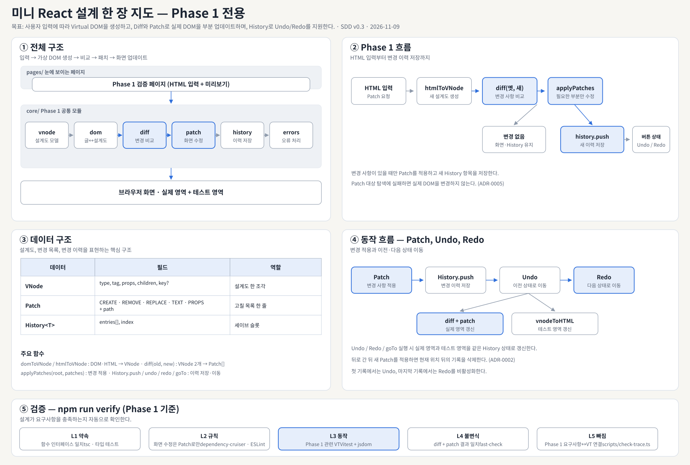
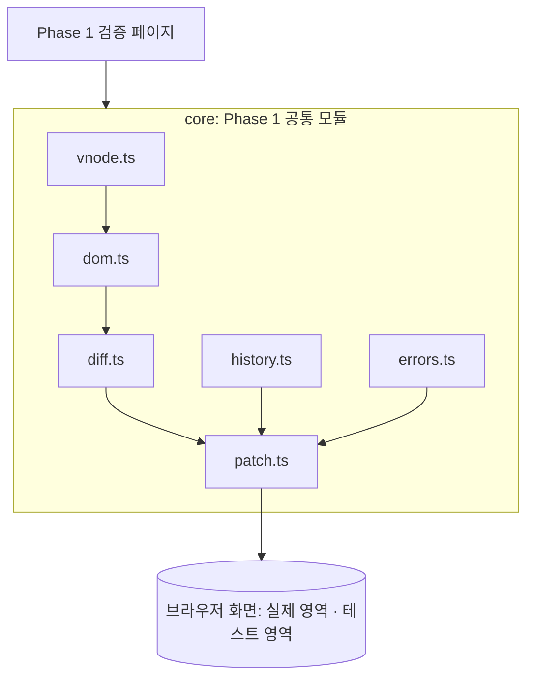
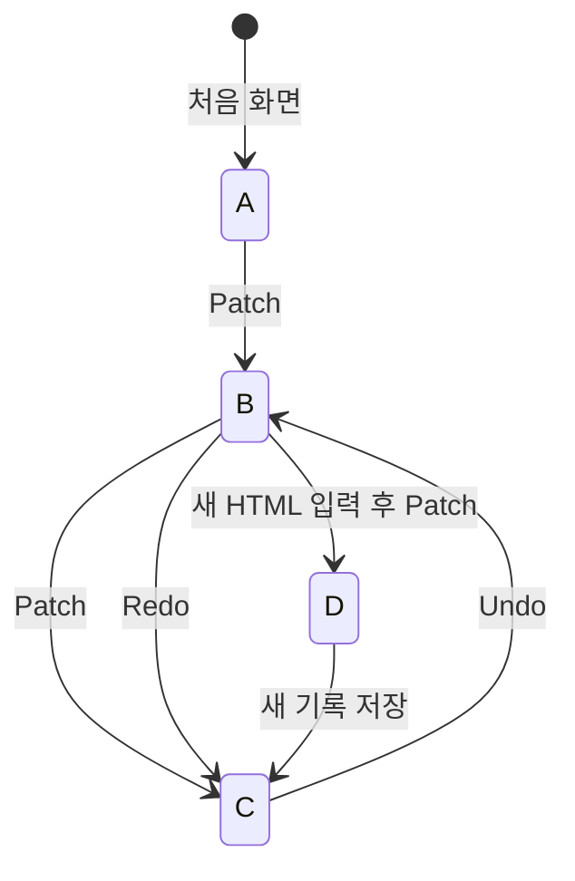

# 미니 React 설계 한 장 요약 (SDD One-Pager)

> 형식: IEEE 1016-2009 (Software Design Descriptions)의 목차를 한 장으로 줄인 것. 자세한 내용은 전체 설계문서 `SDD.md`, 결정 이유는 `docs/adr/`에 기록한다.

| 항목 | 내용 |
|---|---|
| 문서 | 미니 React Phase 1 소프트웨어 설계 요약 v0.3 (Draft, 팀 검토 전) |
| 날짜 | 2026-11-09 |
| 기준 | SRS v1.0 (ISO/IEC/IEEE 29148), ADR-0001 TypeScript |
| 작성 | 프로젝트 팀 (초안: AI, 결정·검토: 팀) |



## 1. 목표 (LMS 과제 요구사항)

- 사용자의 HTML 입력에 따라 Virtual DOM을 생성하고 변경 사항을 비교하는 웹 페이지를 만든다.
- 핵심은 **전체를 다시 그리지 않고 필요한 부분만 업데이트**하는 것이다.
- Diff로 변경 사항을 찾고 Patch로 실제 DOM을 수정한다.
- **Undo/Redo**로 History에 저장된 특정 Virtual DOM 상태로 이동한다.
- Undo/Redo 실행 시 **실제 영역과 테스트 영역을 함께** 갱신한다.

## 2. 쉬운 말 사전

| 어려운 말 | 쉬운 비유 |
|---|---|
| 실제 DOM / Virtual DOM | 실제로 쌓은 레고 집 / 그 집의 설계도 |
| Diff / Patch | 설계도 두 장으로 틀린 그림 찾기 / 틀린 블록만 갈아끼우기 |
| History | 게임 세이브 슬롯 (Undo = 이전 칸, Redo = 다음 칸) |
| 하네스 / ADR | 자동 채점기 / "왜 이렇게 정했는지" 기록한 문서 |

## 3. 읽는 사람과 궁금한 점 (Stakeholders & Concerns)

| 읽는 사람 | 궁금한 점 | 볼 곳 |
|---|---|---|
| 구현 담당 | 내 함수의 입력·출력, 모듈 간 약속 | 4, 5장 |
| 테스트 담당 | VT를 어떻게 확인하나 | 7장 |
| 발표자·새 팀원 | 전체 흐름과 결정 이유 | 지도, 6장 |
| AI 코딩 도구 | 지켜야 할 규칙, 통과할 검사 | 4, 7장, `AGENTS.md` |

## 4. 구조와 의존 (Composition · Dependency)

화살표는 모듈 간 의존 방향을 나타낸다. **실제 DOM을 수정하는 코드는 `core/patch.ts` 하나뿐**이다.



```text
src/
  core/
    vnode.ts
    dom.ts
    diff.ts
    patch.ts
    history.ts
    errors.ts
  pages/
    phase1/
      index.html
      main.ts
      init.ts
tests/
  unit/
  integration/
  property/
  helpers/
docs/
  SRS.md
  SDD.md
  SDD_one_page.md
  design_map_phase1.svg
  adr/
```

## 5. 데이터와 함수 약속 (Information · Interface)

| 데이터 | 필드 | 역할 |
|---|---|---|
| `VNode` | `type`, `tag`, `props`, `children`, `key?` | Virtual DOM 노드 |
| `Patch` | `CREATE`·`REMOVE`·`REPLACE`·`TEXT`·`PROPS` + `path` | DOM 변경 작업 |
| `History<T>` | `entries[]`, `index` | 상태 및 현재 기록 위치 |

| 주요 함수 | 입력 → 출력 | 하는 일 |
|---|---|---|
| `domToVNode(node)` / `htmlToVNode(html)` | DOM·HTML → `VNode` | DOM을 Virtual DOM으로 변환 |
| `diff(old, new)` | `VNode` 2개 → `Patch[]` | 변경 사항 비교 |
| `applyPatches(root, patches)` | DOM, `Patch[]` → 결과 | Patch를 실제 DOM에 적용 |
| `History.push()` | 새 상태 → 상태 | 변경 이력 저장 |
| `History.undo()` | 이전 상태 또는 `null` | 이전 기록으로 이동 |
| `History.redo()` | 다음 상태 또는 `null` | 다음 기록으로 이동 |
| `History.goTo(i)` | 인덱스 → 상태 또는 `null` | 특정 기록으로 이동 |
| `vnodeToHTML(vnode)` | `VNode` → HTML 문자열 | 테스트 영역에 표시할 HTML 생성 |

전체 함수 명세는 `SDD.md` 3장 및 관련 부록을 참고한다.

## 6. 동작 흐름과 결정 이유 (Interaction · State · Rationale)

**Phase 1: Patch**

입력칸의 HTML → `htmlToVNode` → `diff(이전 VNode, 새 VNode)` → 변경 사항이 있으면 `applyPatches` → `history.push` → 버튼 상태 갱신.

변경 사항이 없으면 History에 새 기록을 추가하지 않는다.

**Phase 1: Undo / Redo**

`history.undo()` 또는 `history.redo()` → 이전 VNode와 이동할 VNode 비교 → `diff + applyPatches`로 실제 영역 갱신 → `vnodeToHTML`로 테스트 영역 갱신.

두 영역은 동일한 History 상태를 기준으로 함께 변경한다.



| ADR | 결정 | 상태 |
|---|---|---|
| 0001 | TypeScript 사용 | accepted |
| 0002 | 뒤로 간 뒤 새로 Patch하면 뒤쪽 기록 삭제 | proposed |
| 0003 | 테스트 영역은 HTML 입력칸 + 미리보기 | proposed |
| 0004 | 같은 자리끼리 비교 + 5가지 Patch (key는 확장) | proposed |
| 0005 | Patch 대상 경로를 먼저 확인한 뒤 적용 | proposed |
| 0008 | 테스트 하네스: Vitest + jsdom | proposed |
| 0009 | 설계 준수를 하네스로 자동 검증 | proposed |

## 7. 검증 (Verification)

`npm run verify`로 설계와 구현이 요구사항을 충족하는지 확인한다.

| 칸 | 무엇을 보나 | 도구 |
|---|---|---|
| L1 약속 | 함수 이름·입력·출력이 설계와 같나 | `tsc`, 타입 테스트 |
| L2 규칙 | 화면 수정은 Patch를 통해서만 수행하나, 모듈 의존 방향을 지키나 | dependency-cruiser, ESLint |
| L3 동작 | Phase 1 관련 VT가 기대대로 동작하나 | Vitest + jsdom |
| L4 불변식 | 다양한 VNode 쌍에도 `applyPatches(root, diff(a, b))` 결과가 b와 같은가 | fast-check |
| L5 빠짐 | SRS의 Phase 1 관련 VT에 대응하는 테스트가 모두 존재하나 | `scripts/check-trace.ts` |

AI가 작성한 코드를 이해했는지는 **원리 설명 질문 카드**로 확인한다. 담당자가 구현 원리를 설명하지 못하면 PR을 병합하지 않는다.

## 8. 추적성 (요구사항 → 설계 → 검증)

| 요구사항 | 설계 | 검증 | 이슈 |
|---|---|---|---|
| FR-01~02 DOM 변환, 테스트 영역 | 3.2, 3.6 | VT-01, 02, 32~34 | #27 |
| FR-03~06 Patch, 부분 갱신 | 3.3, 3.4 | VT-03~06, 20, 27~29, 31 | |
| FR-07~08 History, Undo/Redo | 3.5, 3.6 | VT-07~09, 30 | #23, #25, #26 |

설계 번호(3.x)는 전체 설계문서 `SDD.md`의 절 번호다. 검증 항목은 SRS v1.0의 Phase 1 관련 VT를 기준으로 한다. FR·VT 번호 및 이슈 대응은 SRS 원문과 최종 대조 후 확정한다.
